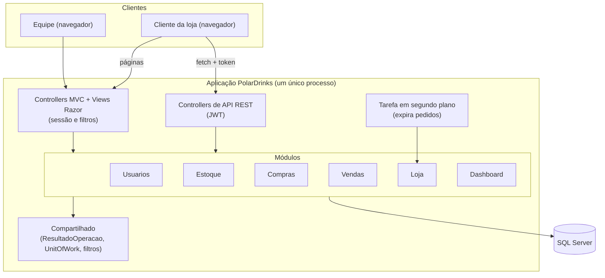
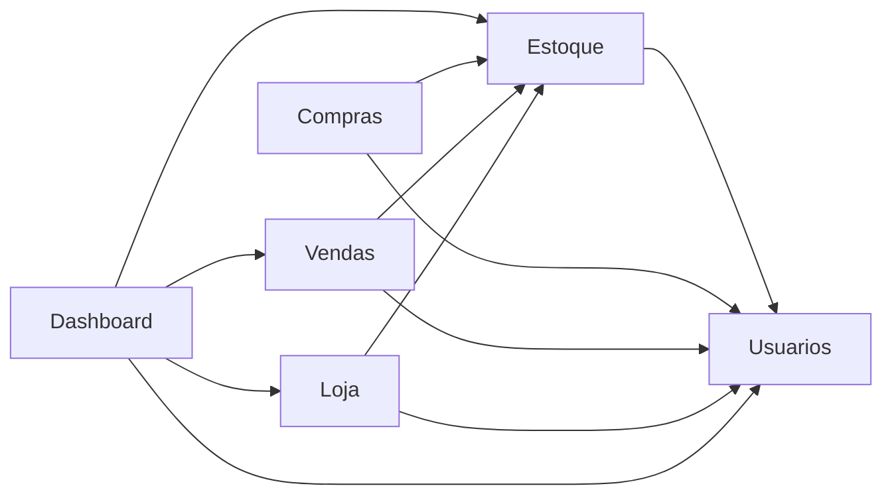
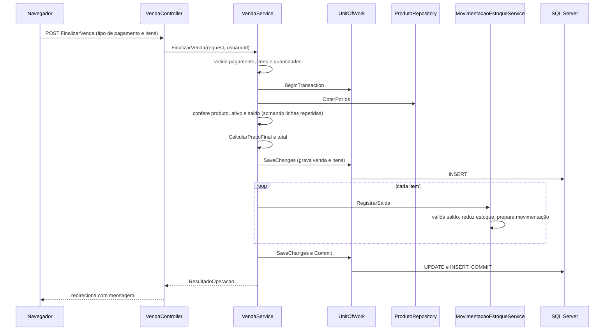

# Arquitetura

Este documento responde: **como o PolarDrinks está estruturado, como uma requisição percorre o sistema e por que as decisões foram tomadas assim**. É um resumo navegável; os detalhes de responsabilidades, dependências e falhas estão no [mapa de responsabilidades](entrega/MAPA-DE-RESPONSABILIDADES.md).

## Sumário

1. [Estilo arquitetural](#1-estilo-arquitetural)
2. [Visão geral](#2-visão-geral)
3. [Camadas](#3-camadas)
4. [Módulos](#4-módulos)
5. [Caminho de uma requisição](#5-caminho-de-uma-requisição)
6. [Injeção de dependências](#6-injeção-de-dependências)
7. [Telas e JavaScript](#7-telas-e-javascript)
8. [Inicialização e tarefa em segundo plano](#8-inicialização-e-tarefa-em-segundo-plano)
9. [Decisões arquiteturais](#9-decisões-arquiteturais)
10. [Limitações da arquitetura](#10-limitações-da-arquitetura)

---

## 1. Estilo arquitetural

O PolarDrinks é um **monólito em camadas organizado em módulos**:

- **Monólito:** um único projeto web e um único banco SQL Server. Telas administrativas, telas da loja, API REST e tarefa em segundo plano rodam no mesmo processo.
- **Camadas:** em cada módulo, o fluxo é `Controller → Service → Repository → Banco`.
- **Módulos:** o código é separado por assunto de negócio (Estoque, Vendas, Compras, Loja, Dashboard e Usuários), e cada módulo tem as próprias camadas.
- **MVC:** as telas são Controllers com Views Razor. MVC cuida da interação com a tela; as camadas cuidam da responsabilidade técnica. Uma coisa não substitui a outra.

Não é microsserviço (há um só processo e um só banco) e também não é um monólito modular rígido: os módulos compartilham o mesmo projeto e o mesmo `ApplicationDbContext`. As fronteiras entre eles são mantidas por **regras verificadas em teste**, não por projetos separados.

## 2. Visão geral

Existem **duas portas de entrada**, com autenticação diferente: as telas administrativas usam sessão e filtros; a API da loja usa token JWT. As duas chegam aos mesmos serviços dos módulos.

## 3. Camadas

| Camada | Responsabilidade | O que não deve fazer | Verificado por |
|---|---|---|---|
| **Controller** | Receber a requisição, chamar o serviço e escolher a resposta (View, redirecionamento ou JSON) | Acessar repository ou banco; conter regra de negócio | Teste de arquitetura R4 |
| **Service** | Executar o caso de uso: validar, aplicar as regras, coordenar repositórios e a transação | Usar tipos da camada web (`IFormFile`, ViewModels de tela) | R5 |
| **Repository** | Consultar e preparar alterações com o Entity Framework | Decidir regra de negócio | Convenção e revisão |
| **Model** | Entidades e contratos de dados (e regras que protegem a própria entidade, como `CalcularPrecoFinal`) | Depender de Services, Repositories ou Controllers | R6 |
| **Compartilhado** | Código comum (`ResultadoOperacao`, `IUnitOfWork`, filtros, expansor de Views) | Depender de qualquer módulo | R7 |

As regras R1 a R9 estão descritas no mapa de responsabilidades (seção 3) e rodam com `dotnet test --filter "Categoria=Arquitetura"`.

**Resultado das operações.** Os Services não lançam exceção para erros esperados (saldo insuficiente, dado inválido). Eles devolvem `ResultadoOperacao` ou `ResultadoOperacao<T>`, com sucesso, mensagem e, quando faz sentido, o campo com erro. O Controller só traduz isso para a resposta.

## 4. Módulos

| Módulo | Assunto | Controllers | Repositories |
|---|---|---|---|
| `Usuarios` | Login, logout e gestão de usuários | `AuthController`, `UsuarioController` | `UsuarioRepository` |
| `Estoque` | Produtos, categorias, movimentações e imagens | `EstoqueController`, `CategoriaController` | `ProdutoRepository`, `CategoriaRepository`, `MovimentacaoEstoqueRepository` |
| `Compras` | Compras e fornecedores | `CompraEstoqueController`, `FornecedorController` | `CompraEstoqueRepository`, `FornecedorRepository` |
| `Vendas` | Vendas no balcão | `VendaController` | `VendaRepository` |
| `Loja` | Catálogo, carrinho, conta do cliente, pedidos e atendimento | `LojaController`, `PedidoOnlineController` e 4 controllers de API | `ClienteRepository`, `CarrinhoRepository`, `PedidoRepository` |
| `Dashboard` | Indicadores e previsões | `DashboardController` | nenhum (usa os repositories de Vendas, Loja e Estoque) |

Cada seta indica uma **dependência permitida** (quem pode usar quem). Quase todos os módulos também podem registrar o usuário responsável por uma operação, por isso apontam para `Usuarios`.

Duas ideias sustentam o desenho:

- **O Estoque é o dono do saldo e do preço final.** Vendas, Compras e Loja pedem a ele a saída, a devolução ou a entrada de mercadoria; nenhum altera a quantidade por conta própria.
- **O Dashboard só lê.** Ele consome resultados de Vendas, Loja e Estoque e não tem regra de atualização.

## 5. Caminho de uma requisição

Ordem dos componentes que toda requisição atravessa, conforme `Program.cs`:

| Ordem | Componente | O que faz |
|---|---|---|
| 1 | Tratador de exceção (`/Home/Error`) | Só fora do ambiente de desenvolvimento; mostra a página de erro |
| 2 | Cultura da requisição | Fixa a cultura `en-US` para toda a aplicação |
| 3 | Roteamento | Descobre qual Controller e ação atendem a URL |
| 4 | Sessão | Carrega a sessão da equipe (30 minutos sem uso) |
| 5 | Autenticação e autorização | Valida o token JWT quando a ação exige `[Authorize]` |
| 6 | Arquivos estáticos | CSS, JavaScript e imagens |
| 7 | Rota padrão | `{controller=Auth}/{action=Login}/{id?}`: quem abre o site cai na tela de login |

Os filtros `AuthFilter` e `AdminFilter` rodam logo antes da ação do Controller e leem a sessão.

Exemplo completo, a **venda no balcão**. O serviço grava a venda primeiro (para obter os identificadores dos itens) e só depois dá a saída de estoque de cada item, tudo dentro da mesma transação:

Se qualquer etapa falhar, o serviço chama `Rollback` e devolve o erro, sem deixar venda, baixa ou movimentação parcial. Os outros fluxos críticos (checkout, cancelamentos, entrada de compra e expiração) seguem o mesmo princípio e serão detalhados em [08-fluxos-principais](08-fluxos-principais.md).

## 6. Injeção de dependências

Tudo é registrado em `Program.cs` com ciclo de vida **`Scoped`** (uma instância por requisição):

- **Repositories:** um por entidade, sempre com a interface (`IProdutoRepository`, `IVendaRepository` e assim por diante).
- **Services:** um por caso de uso, também com interface (`IVendaService`, `IPedidoService`...).
- **`IUnitOfWork`:** um por requisição, compartilhando o mesmo `ApplicationDbContext` dos repositories. Por isso o que um repository prepara pode ser gravado pelo `SaveChanges` do serviço.
- **`ApplicationDbContext`:** configurado com `UseSqlServer` e a cadeia `DefaultConnection`.

Como o contexto é compartilhado na requisição, quem grava é o **Service**, pelo `IUnitOfWork` (política detalhada no mapa de responsabilidades, seção 6).

A tarefa em segundo plano não faz parte de uma requisição, por isso cria o próprio escopo a cada execução para obter o `IPedidoService`.

## 7. Telas e JavaScript

| Área | Como é montada |
|---|---|
| **Administração** | Views Razor renderizadas no servidor, em `Modules/<Modulo>/Views`. O `ModuloViewLocationExpander` faz o MVC procurar a View na pasta do módulo do Controller. Telas compartilhadas (início e erros) ficam em `Views/` |
| **Loja online** | As páginas (catálogo, carrinho, conta, perfil, confirmação) são Views Razor que servem só a "casca"; os dados vêm de **JavaScript que chama a API** (`wwwroot/js/loja`) |
| **Token do cliente** | Guardado no navegador (`localStorage`, chave `polardrinks_token`) e enviado no cabeçalho `Authorization: Bearer` pelo `chamarApi` |
| **Carrinho antes do login** | Fica no navegador (`carrinho_local`) e é mesclado ao carrinho da conta ao entrar (`POST api/carrinho/mesclar`) |
| **Dashboard e vendas** | `dash.js` e `vendas.js` em `wwwroot/js` |

## 8. Inicialização e tarefa em segundo plano

**Ao iniciar a aplicação:**
1. As migrations pendentes são aplicadas (`Database.Migrate()`), então o banco é criado ou atualizado sozinho.
2. Se não existe nenhum usuário, é criado o Admin inicial (login `admin`, senha `admin123`). **Troque essa senha em qualquer ambiente real.**

**Tarefa `ExpiracaoPedidosJob`** (serviço em segundo plano do módulo Loja):
- roda a cada 15 minutos;
- chama `IPedidoService.ExpirarPedidosNaoRetirados`, que cancela pedidos separados há 24 horas ou mais e devolve o estoque;
- cada pedido é processado separadamente, então a falha em um não impede os outros;
- erros da execução são escritos no console e a tarefa continua no próximo ciclo.

## 9. Decisões arquiteturais

| Decisão | Motivo | Consequência |
|---|---|---|
| Monólito em vez de serviços separados | Venda e baixa de estoque precisam ser uma única transação; o tamanho do sistema não justifica o custo de distribuição | Qualquer parte do sistema é implantada junta |
| Módulos por pasta, num só projeto | Tornar os assuntos de negócio visíveis sem a complexidade de vários projetos | As fronteiras dependem dos testes de arquitetura, não do compilador |
| Estoque como dono do saldo e do preço | Evitar que cada fluxo calcule ou altere por conta própria | Todo fluxo novo que mexe em saldo precisa usar `IMovimentacaoEstoqueService` |
| Um único `ApplicationDbContext` | Um banco, um mapeamento, migrations simples | Os módulos compartilham o mapeamento das entidades |
| Um repository por entidade, dentro do módulo dono | Consultas ficam perto de quem as usa | Alguns módulos leem produtos pelo repository do Estoque (limitação conhecida) |
| `IUnitOfWork` na camada de serviço | Deixar claro quem decide quando gravar e permitir rollback | Os Services dependem de uma interface de transação, não do EF |
| `ResultadoOperacao` em vez de exceções para erros esperados | Fluxo explícito e fácil de testar | Cada Controller precisa traduzir o resultado |
| Sessão para a equipe e JWT para o cliente | Dois públicos com necessidades diferentes: telas do servidor e API consumida por JavaScript | Existem dois mecanismos de autenticação para manter |
| Contratos HTTP próprios (`Request` e `Response`) | O cliente só pode informar o necessário e só recebe o permitido | Há classes de mapeamento a mais |
| Regras de arquitetura como testes | Uma regra que ninguém verifica deixa de valer com o tempo | Mudar uma fronteira exige alterar a regra e justificar |

## 10. Limitações da arquitetura

- **Fronteiras por teste, não por compilador.** Um desenvolvedor pode, deliberadamente, alterar as regras de arquitetura. A proteção depende de revisão.
- **Models acoplados ao banco.** As entidades usam anotações do Entity Framework e `RowVersion`; não há um domínio isolado de infraestrutura.
- **Serviços síncronos.** Nenhum método de serviço usa `async`; sob muita carga, cada requisição ocupa uma thread durante o acesso ao banco.
- **Leitura entre módulos.** Vendas, Compras e Loja leem produtos diretamente pelo repository do Estoque, sem um contrato de leitura próprio.
- **Dashboard.** Ainda carrega parte do histórico de vendas em memória para gráficos e previsão.
- **Segredos no repositório.** A chave do JWT e a conexão estão em arquivo de configuração versionado; devem sair para variáveis de ambiente.
- **API sem documentação gerada.** Não há OpenAPI; a referência é o [documento da API](05-api.md) e o arquivo `PolarDrinks.http`.
