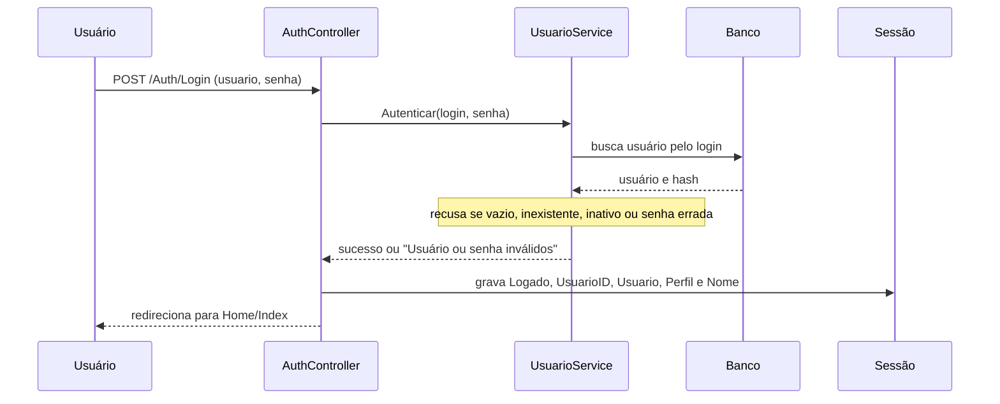
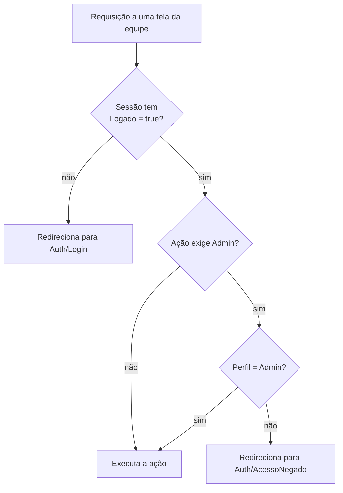

# Autenticação e permissões

Este documento responde: **como o sistema sabe quem é a pessoa, o que cada perfil pode fazer e quais são os limites de segurança do projeto hoje**. As rotas protegidas estão listadas em [05-api](05-api.md); as regras de usuário, em [01-visao-e-requisitos](01-visao-e-requisitos.md) (RF01 a RF04).

## Sumário

1. [Dois mecanismos](#1-dois-mecanismos)
2. [Equipe: sessão e filtros](#2-equipe-sessão-e-filtros)
3. [Perfis e permissões](#3-perfis-e-permissões)
4. [Gestão de usuários](#4-gestão-de-usuários)
5. [Cliente da loja: JWT](#5-cliente-da-loja-jwt)
6. [Senhas](#6-senhas)
7. [Configuração e segredos](#7-configuração-e-segredos)
8. [Testes](#8-testes)
9. [Limitações](#9-limitações)

---

## 1. Dois mecanismos

O projeto tem dois públicos com cadastros separados, e cada um usa um mecanismo próprio:

| | Equipe (Admin e Funcionário) | Cliente da loja |
|---|---|---|
| **Cadastro** | Tabela `Usuarios` | Tabela `Clientes` |
| **Como entra** | Tela de login (`Auth/Login`) | `POST /api/cliente/auth/login` |
| **Prova de identidade** | **Sessão** no servidor (cookie de sessão) | **JWT** enviado em `Authorization: Bearer` |
| **Duração** | 30 minutos sem uso | 24 horas |
| **Onde é verificado** | Filtros `AuthFilter` e `AdminFilter` | `[Authorize]` nos controllers da API |
| **Perfis** | Admin e Funcionário | Não há perfis |

Os dois não se misturam: o token do cliente não abre as telas da equipe, e a sessão da equipe não autentica chamadas à API (o esquema de autenticação padrão do ASP.NET é o JWT).

## 2. Equipe: sessão e filtros

### 2.1 Login

A mensagem de falha é **a mesma** para campo vazio, usuário inexistente, usuário inativo e senha errada ("Usuário ou senha inválidos"), para não revelar qual login existe.

Dados guardados na sessão ao entrar:

| Chave | Conteúdo | Para que serve |
|---|---|---|
| `Logado` | `"true"` | `AuthFilter` |
| `Perfil` | `Admin` ou `Funcionario` | `AdminFilter`, escolha do layout, botões nas telas |
| `UsuarioID` | Identificador | Registrar quem fez a venda, a compra, a movimentação |
| `Usuario` | Login | Conferir a senha de quem está logado em ações sensíveis |
| `Nome` | Nome de exibição | Mostrar na tela |

O logout (`POST /Auth/Logout`) limpa a sessão. A sessão expira após 30 minutos sem requisição e o cookie é `HttpOnly`.

### 2.2 Os dois filtros

Eles são atributos que rodam **antes** da action e, se a condição falhar, devolvem um redirecionamento sem executar a ação:

| Filtro | Verifica | Se falhar |
|---|---|---|
| `AuthFilter` | `Logado == "true"` na sessão | Vai para o login |
| `AdminFilter` | `Perfil == "Admin"` na sessão | Vai para "Acesso negado" |

Onde ficam: nos controllers inteiros (por exemplo, `UsuarioController` e `DashboardController`) ou em ações específicas (por exemplo, `Estoque/Cadastrar`). As telas públicas (`Auth`, `Loja`) não têm filtro.

Os filtros ficam em `Compartilhado/Filters`, porque são usados por vários módulos. A regra de arquitetura R7 garante que `Compartilhado` não dependa de nenhum módulo.

## 3. Perfis e permissões

Resumo por capacidade. A lista completa, ação por ação, está na [seção 9 do doc 05](05-api.md#9-telas-da-equipe-mvc).

| Capacidade | Funcionário | Admin |
|---|:-:|:-:|
| Entrar e sair | ✔ | ✔ |
| Registrar venda no balcão | ✔ | ✔ |
| Ver a lista de produtos e de fornecedores | ✔ | ✔ |
| Atender pedidos online (separar, voltar, entregar, histórico) | ✔ (veja a seção 9) | ✔ |
| Cadastrar/editar produto, edição rápida, ajustar estoque, ver movimentações | ✘ | ✔ |
| Categorias | ✘ | ✔ |
| Cadastrar/editar fornecedor | ✘ | ✔ |
| Compras (cadastrar, confirmar entrega, excluir) | ✘ | ✔ |
| Histórico, detalhe e cancelamento de vendas | ✘ | ✔ |
| Cancelar pedido após a entrega | ✘ | ✔ |
| Dashboard | ✘ | ✔ |
| Gerenciar usuários | ✘ | ✔ |

A interface também se adapta ao perfil, mas isso é **conforto, não segurança**: `_ViewStart.cshtml` escolhe o layout do Funcionário (`_LayoutFun`, com menu menor) e algumas telas escondem botões de Admin. A proteção real está nos filtros do servidor: quem digitar o endereço de uma tela de Admin sem ser Admin cai em "Acesso negado".

## 4. Gestão de usuários

Todo o `UsuarioController` é restrito ao Admin (RF02 a RF04). As regras ficam em `UsuarioService`:

| Operação | Regras | Exige senha de quem? |
|---|---|---|
| **Cadastrar** | Nome e login obrigatórios; senha com pelo menos 6 caracteres e igual à confirmação; login único; perfil `Admin`, ou qualquer outro valor vira `Funcionario` | Do **Admin logado** |
| **Alterar senha** | Senha atual do usuário alterado correta; nova senha com pelo menos 6 caracteres e igual à confirmação | Do **usuário que está tendo a senha alterada** |
| **Desativar / reativar** | Não pode desativar a própria conta; não pode desativar o único Admin ativo | Do **Admin logado** |

Pontos de atenção:

- "Desativar" é um interruptor: o mesmo comando reativa um usuário inativo. Não há exclusão de usuários.
- Pedir a senha de quem está logado antes de ações sensíveis (cadastrar e desativar) reduz o estrago de uma tela esquecida aberta.
- Como a troca de senha pede a senha atual **do usuário alterado**, o Admin não consegue redefinir a senha de alguém que a esqueceu; e o Funcionário não tem tela para trocar a própria. Não há recuperação por e-mail.

## 5. Cliente da loja: JWT

### 5.1 Cadastro e login

Ambos terminam devolvendo um **token JWT**. O cadastro já devolve o token (o cliente entra logo após criar a conta). Detalhes dos contratos estão no [doc 05](05-api.md#5-conta-do-cliente).

| Parâmetro | Valor | Onde configurar |
|---|---|---|
| Algoritmo | HMAC-SHA256 (HS256) | `TokenService` |
| Duração | 24 horas | `Jwt:DuracaoEmHoras` |
| Emissor e audiência | `PolarDrinksAPI` (o mesmo valor para os dois) | `Jwt:Emissor` |
| Chave de assinatura | Segredo compartilhado | `Jwt:ChaveSecreta` |
| Conteúdo (claims) | Identificador, e-mail e nome do cliente | `TokenService` |

O servidor valida emissor, audiência, assinatura e validade em toda chamada protegida. O ASP.NET aplica por padrão uma tolerância de relógio de 5 minutos, então na prática o token vale um pouco mais que 24 horas.

### 5.2 Como a API sabe quem é o cliente

Os controllers `CarrinhoController` e `PedidoController` têm `[Authorize]` e leem o identificador do cliente **do token** (`ClaimTypes.NameIdentifier`). O cliente nunca informa o próprio identificador no corpo ou na rota. Por isso:

- o carrinho e os pedidos consultados são sempre os do dono do token;
- pedir o pedido de outro cliente devolve `404`, como se o pedido não existisse (a consulta filtra pelo identificador do cliente junto com o do pedido);
- o código de retirada só é devolvido ao dono do pedido.

No navegador, o token fica no `localStorage` (chave `polardrinks_token`) e é enviado pelo JavaScript da loja (`wwwroot/js/loja`).

## 6. Senhas

| Item | Equipe | Cliente |
|---|---|---|
| Armazenamento | Hash **BCrypt** em `UsuarioSenhaHash` | Hash **BCrypt** em `ClienteSenhaHash` |
| Tamanho mínimo | 6 caracteres | 6 caracteres |
| Confirmação | Exigida no cadastro e na troca | Exigida no cadastro |
| Mensagem de falha no login | Genérica (usuário ou senha) | Genérica (e-mail ou senha); a conta inativa é informada só depois de a senha conferir |

Nenhuma senha em texto puro é gravada ou registrada. Não há exigência de complexidade além do tamanho mínimo.

## 7. Configuração e segredos

| O que | Onde está | Valor no repositório |
|---|---|---|
| Admin inicial | `Program.cs` (criado se não houver nenhum usuário) | login `admin`, senha `admin123` |
| Chave do JWT | `appsettings.json` | Texto de exemplo terminando em "Trocar-Em-Producao" |
| Conexão com o banco (local) | `appsettings.json` | Servidor local com autenticação do Windows |
| Senha do SQL Server no Docker | `docker-compose.yml` | `SuaSenhaForte123!` (exemplo) |

Estes valores servem para desenvolvimento e estudo. **Antes de qualquer uso real**, é preciso:

1. trocar a senha do `admin` no primeiro acesso (ou criar outro Admin e desativar o inicial);
2. substituir `Jwt:ChaveSecreta` por um segredo longo e aleatório, fornecido por variável de ambiente (`Jwt__ChaveSecreta`) ou serviço de segredos, e não por arquivo versionado;
3. trocar a senha do SQL Server do `docker-compose.yml`;
4. publicar atrás de HTTPS (veja as limitações abaixo).

## 8. Testes

Não há testes automatizados dedicados à autenticação: nem para `AuthFilter`/`AdminFilter`, nem para `UsuarioService.Autenticar`, nem para `TokenService` ou o login do cliente. O que existe de relacionado:

- `PedidoControllerContratoTests` confirma o formato de resposta de pedidos (sem dados internos).
- `SmokeTests` só confere o tipo `ResultadoOperacao`; não toca em login nem em permissões.

A verificação das permissões é manual: o roteiro está em [10-guia-de-testes](10-guia-de-testes.md).

## 9. Limitações

Estas limitações são conhecidas e ficam registradas aqui para não parecerem esquecimentos.

**Credenciais e configuração**

- **Credenciais de exemplo no repositório:** `admin`/`admin123`, a chave do JWT e a senha do SQL Server do Docker. Veja a seção 7 para o que trocar.
- **Sem HTTPS no próprio aplicativo.** Não há redirecionamento para HTTPS nem HSTS, e o contêiner expõe HTTP na porta 8080. Em produção, o aplicativo precisa ficar atrás de um proxy com TLS; do contrário, senhas e tokens trafegam sem criptografia.

**Sessão da equipe**

- **Desativar um usuário não encerra a sessão dele.** O `AuthFilter` só olha a sessão, sem consultar o banco. Um usuário desativado continua operando até a sessão expirar (30 minutos sem uso, renovados a cada requisição).
- **O perfil é lido uma vez, no login.** Uma mudança de perfil só valeria no próximo login (hoje não há tela para editar o perfil de um usuário existente).
- **A sessão fica na memória do processo** (o `Program.cs` não configura Redis nem SQL). Reiniciar o aplicativo desconecta todos, e rodar várias instâncias exigiria um armazenamento compartilhado.
- **O identificador da sessão não é renovado no login.** O login grava os dados na sessão existente, sem gerar uma nova.
- **Sem limite de tentativas de login** (equipe e cliente): nada bloqueia tentativas repetidas de senha.

**Perfis e usuários**

- **O Funcionário não tem atalho para os pedidos online.** O controller permite (`PedidoOnline` exige só login), mas o menu do Funcionário (`_LayoutFun`) tem apenas links para início, venda, estoque e fornecedores. Ele só chega aos pedidos digitando o endereço `/PedidoOnline`. Se a intenção é que o Funcionário atenda pedidos, falta o item de menu.
- **Sem recuperação de senha** nem troca da própria senha pelo Funcionário (seção 4).

**Cliente e API**

- **Token no `localStorage`.** Qualquer script injetado na página (XSS) conseguiria lê-lo. O cookie `HttpOnly` evitaria isso, mas exigiria mudar o desenho.
- **Sem revogação de token.** Desativar um cliente impede novos logins, mas um token já emitido continua válido até expirar, porque a conta só é verificada no login.
- **Proteção contra CSRF e requisições `GET` que alteram dados** (por exemplo, "Confirmar entrega" de compra): veja a [seção 11 do doc 05](05-api.md#11-limitações).

**Testes**

- **Nenhuma regra de autenticação ou autorização tem teste automatizado** (seção 8).
