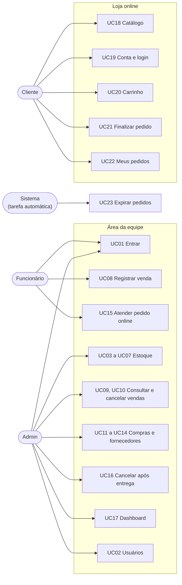

# Casos de uso

Este documento responde: **o que cada pessoa consegue fazer no sistema, passo a passo, e o que acontece quando algo dá errado**. Cada caso de uso aponta para os requisitos de [01-visao-e-requisitos](01-visao-e-requisitos.md) (RF) e para o código que o executa. Os fluxos mais complexos (venda, checkout, cancelamentos) são detalhados com diagramas em [08-fluxos-principais](08-fluxos-principais.md).

As mensagens entre aspas são as que o sistema realmente devolve.

## Sumário

1. [Visão geral](#1-visão-geral)
2. [Acesso e usuários](#2-acesso-e-usuários) (UC01, UC02)
3. [Estoque](#3-estoque) (UC03 a UC07)
4. [Vendas no balcão](#4-vendas-no-balcão) (UC08 a UC10)
5. [Compras e fornecedores](#5-compras-e-fornecedores) (UC11 a UC14)
6. [Atendimento de pedidos online](#6-atendimento-de-pedidos-online) (UC15, UC16)
7. [Dashboard](#7-dashboard) (UC17)
8. [Loja online (cliente)](#8-loja-online-cliente) (UC18 a UC22)
9. [Tarefa automática](#9-tarefa-automática) (UC23)
10. [Cobertura dos requisitos](#10-cobertura-dos-requisitos)
11. [Limitações observadas](#11-limitações-observadas)

---

## 1. Visão geral

O Admin também executa tudo o que o Funcionário faz (UC08 e UC15); para não poluir o diagrama, essas ligações não foram desenhadas.

| ID | Caso de uso | Ator | Requisitos |
|---|---|---|---|
| UC01 | Entrar e sair | Equipe | RF01 |
| UC02 | Gerenciar usuários | Admin | RF02 a RF04 |
| UC03 | Cadastrar e editar produto | Admin | RF05 |
| UC04 | Alterar preço e promoção | Admin | RF06 |
| UC05 | Ajustar estoque | Admin | RF07 |
| UC06 | Consultar estoque e movimentações | Equipe / Admin | RF08, RF10 |
| UC07 | Gerenciar categorias | Admin | RF09 |
| UC08 | Registrar venda no balcão | Equipe | RF11, RF12 |
| UC09 | Consultar vendas | Admin | RF13 |
| UC10 | Cancelar venda | Admin | RF14 |
| UC11 | Gerenciar fornecedores | Admin | RF15 |
| UC12 | Registrar compra | Admin | RF16 |
| UC13 | Confirmar entrega da compra | Admin | RF17 |
| UC14 | Excluir compra pendente | Admin | RF18 |
| UC15 | Atender pedido online | Equipe | RF19, RF20, RF21, RF23 |
| UC16 | Cancelar pedido após a entrega | Admin | RF22 |
| UC17 | Consultar o dashboard | Admin | RF24 a RF26 |
| UC18 | Consultar o catálogo | Público | RF27 |
| UC19 | Criar conta e entrar | Público | RF28 |
| UC20 | Usar o carrinho | Cliente | RF29, RF30 |
| UC21 | Finalizar pedido | Cliente | RF31 |
| UC22 | Consultar e cancelar meus pedidos | Cliente | RF32, RF33 |
| UC23 | Expirar pedidos não retirados | Sistema | RF34 |

---

## 2. Acesso e usuários

### UC01 Entrar e sair

**Ator:** Equipe. **Código:** `AuthController` → `UsuarioService.Autenticar`.

**Fluxo principal**
1. A pessoa abre o sistema (a página inicial é o login) e informa usuário e senha.
2. O sistema confere o usuário, se está ativo e a senha (BCrypt).
3. Cria a sessão com identificação e perfil e leva a pessoa à tela inicial.
4. Para sair, a pessoa confirma em "Deslogar" e a sessão é limpa.

**Alternativos e erros**
- Campo vazio, usuário inexistente, usuário inativo ou senha errada: sempre "Usuário ou senha inválidos".
- Sessão ociosa por 30 minutos: a próxima ação leva de volta ao login.
- Funcionário abrindo tela de Admin: "Acesso negado".

### UC02 Gerenciar usuários

**Ator:** Admin. **Código:** `UsuarioController` → `UsuarioService`.

**Fluxo principal: cadastrar**
1. O Admin informa nome, login, senha, confirmação e perfil, e a **própria senha** para autorizar.
2. O sistema valida e cria o usuário ativo, com a senha em hash.

**Fluxo: alterar senha.** O Admin escolhe o usuário e informa a senha atual **dele**, a nova senha e a confirmação.

**Fluxo: desativar ou reativar.** O Admin escolhe o usuário e informa a própria senha; o sistema inverte a situação ativo/inativo.

**Alternativos e erros**
- "Informe o nome do usuário." / "Informe o login do usuário."
- "A senha deve ter pelo menos 6 caracteres." / "As senhas não conferem."
- "Já existe um usuário com esse login."
- "Senha atual incorreta." (cadastro e troca de senha) / "Senha incorreta." (desativar)
- "Você não pode desativar sua própria conta."
- "Não é possível desativar o único administrador ativo."
- Perfil informado diferente de `Admin` vira `Funcionario`.

---

## 3. Estoque

### UC03 Cadastrar e editar produto

**Ator:** Admin. **Código:** `EstoqueController` → `EstoqueService.CadastrarProduto` / `EditarProduto`.

**Fluxo principal: cadastrar**
1. O Admin preenche nome, descrição, código de barras, custo, preço de venda, promoção, **quantidade inicial**, estoque mínimo, situação, categorias e, opcionalmente, a imagem.
2. O sistema valida os campos e verifica se o código de barras já existe.
3. Numa transação, grava o produto, salva a imagem e as categorias, e confirma.

**Fluxo: editar.** Mesmos campos, exceto a quantidade em estoque: **a edição não altera o saldo** (para isso existe o UC05). Se nenhuma imagem nova for enviada, a atual é mantida.

**Alternativos e erros**
- Campos obrigatórios, faixas e tamanhos (por exemplo, código de barras com 13 a 20 caracteres) são validados na tela.
- "Este código de barras já está cadastrado."
- Falha ao gravar no cadastro: "Não foi possível cadastrar o produto. Nenhuma alteração foi salva." (e a imagem já gravada é removida).
- "Produto não encontrado." (edição).

**Regra relevante.** A quantidade inicial é gravada diretamente no produto e **não gera movimentação**: o histórico do produto começa vazio, e o saldo inicial só aparece como diferença no primeiro ajuste.

### UC04 Alterar preço e promoção

**Ator:** Admin. **Código:** `EstoqueService.EdicaoRapida`.

**Fluxo principal:** na lista de produtos, o Admin informa o novo preço de venda e a promoção (0 a 100) e salva.

**Erros:** "Preço inválido!" (vazio ou negativo); "Promoção inválida!" (vazia, negativa ou acima de 100); "Produto não encontrado!".

**Regra.** O preço final cobrado é calculado por `CalcularPrecoFinal` (preço menos o desconto, arredondado em 2 casas).

### UC05 Ajustar estoque

**Ator:** Admin. **Código:** `EstoqueService.AjustarEstoque`.

**Fluxo principal**
1. O Admin informa o produto, a nova quantidade e uma justificativa.
2. O sistema calcula a diferença para o saldo atual e grava, de uma vez, o novo saldo e uma movimentação do tipo `Edicao` com essa diferença.

**Erros:** "A nova quantidade não pode ser negativa."; "Informe a descrição da alteração."; "A descrição deve ter no máximo 50 caracteres."; "Produto não encontrado.".

**Regra.** Se a nova quantidade for igual à atual, o saldo não muda e **nenhuma movimentação é criada**.

### UC06 Consultar estoque e movimentações

**Ator:** Equipe (lista de produtos); Admin (movimentações). **Código:** `EstoqueController.Index` / `Movimentacoes`.

**Fluxo principal:** a equipe vê a lista de produtos, com destaque para os de estoque baixo (saldo menor ou igual ao mínimo). O Admin abre as movimentações de um produto e vê cada entrada, saída, cancelamento ou ajuste, com data, responsável e origem (venda, pedido ou compra).

### UC07 Gerenciar categorias

**Ator:** Admin. **Código:** `CategoriaController` → `CategoriaService`.

**Fluxo principal:** o Admin cadastra uma categoria ou edita o nome e a situação (ativa/inativa).

**Erros:** "Informe o nome da categoria."; "Já existe uma categoria com esse nome."; "Categoria não encontrada.".

**Regra.** Só categorias ativas aparecem no cadastro de produto e na loja.

---

## 4. Vendas no balcão

### UC08 Registrar venda no balcão

**Ator:** Equipe. **Código:** `VendaController.FinalizarVenda` → `VendaService.FinalizarVenda`. Detalhes em [08](08-fluxos-principais.md).

**Pré-condição:** usuário logado.

**Fluxo principal**
1. A pessoa monta a lista de itens (produto e quantidade) e escolhe a forma de pagamento.
2. O sistema valida o pedido inteiro **antes** de gravar qualquer coisa (itens, pagamento, quantidades, produtos e saldo, somando linhas repetidas do mesmo produto).
3. Numa transação, grava a venda com os itens (preço e custo definidos pelo servidor) e dá a saída de estoque de cada item.
4. Confirma e responde "Venda realizada com sucesso!".

**Alternativos e erros** (nenhum deles grava nada)
- "Adicione pelo menos um item à venda."
- "Selecione um tipo de pagamento." / "Tipo de pagamento inválido."
- "A quantidade de cada item deve ser maior que zero."
- "Produto não encontrado: ID n" / "Produto inativo: nome" / "Estoque insuficiente para: nome"
- Falha inesperada: "Erro ao salvar venda: (texto técnico)". Tudo é desfeito.

**Regras:** formas de pagamento do balcão são `Dinheiro`, `Pix` e `Cartão` (com til; no checkout online o valor é `Cartao`, sem acento). Preço, custo, total, data e usuário nunca vêm da tela.

### UC09 Consultar vendas

**Ator:** Admin. **Código:** `VendaController.Index` / `Detalhes`.

**Fluxo principal:** o Admin abre o histórico, opcionalmente filtra por período (início e fim) e abre uma venda para ver itens, pagamento e, se cancelada, motivo e responsável.

### UC10 Cancelar venda

**Ator:** Admin. **Código:** `VendaService.CancelarVenda`.

**Fluxo principal**
1. O Admin abre a venda, vê a confirmação e informa o motivo.
2. O sistema devolve ao estoque cada item (movimentação do tipo `Cancelamento`, ligada ao item da venda) e marca a venda como cancelada.

**Erros:** "Venda não encontrada."; "Não é possível cancelar a venda após 24 horas."; "Venda já está cancelada."

**Regras:** só dentro de 24 horas da venda; a devolução ocorre uma única vez (a segunda tentativa é recusada). Vendas canceladas saem do faturamento.

---

## 5. Compras e fornecedores

### UC11 Gerenciar fornecedores

**Ator:** Admin cadastra e edita; Equipe vê a lista. **Código:** `FornecedorController` → `FornecedorService`.

**Fluxo principal:** o Admin informa nome, CNPJ, telefone, e-mail e endereço completo, e salva. Na edição também define se o fornecedor está ativo.

**Erros:** "Este CNPJ já está cadastrado."; "Fornecedor não encontrado."; campos obrigatórios e formato (CNPJ com 18 caracteres e telefone com 15, ou seja, já com máscara).

### UC12 Registrar compra

**Ator:** Admin. **Código:** `CompraEstoqueController.Cadastrar` → `CompraEstoqueService.CadastrarCompra`.

**Fluxo principal**
1. O Admin escolhe o fornecedor e adiciona itens (produto, quantidade e preço de compra).
2. O sistema cria a compra com situação **Aguardando**. O estoque **não** muda.

**Erros:** "Selecione um fornecedor"; "Selecione um produto"; "Quantia inválida" (quantidade menor que 1); "Preço inválido" (menor que 0,01); "Adicione pelo menos um produto".

### UC13 Confirmar entrega da compra

**Ator:** Admin. **Código:** `CompraEstoqueService.ConfirmarEntrega`.

**Fluxo principal**
1. O Admin abre a compra pendente e confirma a entrega.
2. O sistema dá a entrada de cada item no estoque (movimentação `Entrada`, ligada ao item da compra), marca a compra como **Concluído** e registra a data e quem confirmou.
3. Responde "Entrega confirmada e estoque atualizado!".

**Alternativos**
- Compra já concluída: nada é repetido (nenhuma entrada nova) e a operação termina sem erro.
- Compra inexistente: "Compra não encontrada." (a tela mostra "não encontrado").

### UC14 Excluir compra pendente

**Ator:** Admin. **Código:** `CompraEstoqueService.ConfirmarExclusao`.

**Fluxo principal:** o Admin abre a exclusão, confere os dados e confirma; a compra e seus itens são removidos.

**Erros:** "Compra não encontrada."; "Não é possível excluir uma compra já concluída."

---

## 6. Atendimento de pedidos online

### UC15 Atender pedido online

**Ator:** Equipe (a tela fica em `/PedidoOnline`; veja [06, seção 9](06-autenticacao-e-permissoes.md#9-limitações)). **Código:** `PedidoOnlineController` → `PedidoService`.

**Fluxo principal**
1. A pessoa abre a lista, que mostra os pedidos **aguardando separação** e os **separados**.
2. Separa os produtos e marca o pedido como **separado**: o sistema registra a data e quem separou.
3. Quando o cliente chega, a pessoa informa o **código de retirada** que ele apresenta.
4. Se o código confere, o pedido passa a **concluído**, com a data e quem entregou.
5. O histórico lista os pedidos concluídos e cancelados, do mais recente ao mais antigo.

**Alternativos e erros**
- Voltar para separação (pedido separado por engano): o pedido retorna a "aguardando separação" e apaga a data e o responsável.
- "Pedido não encontrado."
- "Este pedido não está aguardando separação." (ao separar)
- "Este pedido não está separado." (ao voltar)
- "Este pedido ainda não foi separado." (ao entregar)
- "Código incorreto. Confira com o cliente."

**Regra.** O estoque **não** muda nesta etapa: a saída já foi dada no checkout (UC21).

### UC16 Cancelar pedido após a entrega

**Ator:** Admin. **Código:** `PedidoService.CancelarAposEntrega`.

**Fluxo principal:** o Admin abre um pedido concluído e informa o motivo. O sistema devolve o estoque (movimentação `CancelamentoOnline`) e marca o pedido como cancelado pelo Admin.

**Erros:** "Pedido não encontrado."; "Este pedido não está concluído."; "O prazo de 24 horas para cancelamento após a entrega já passou."

**Regra.** O prazo conta a partir da **entrega**, não da criação do pedido.

---

## 7. Dashboard

### UC17 Consultar o dashboard

**Ator:** Admin. **Código:** `DashboardController` → `DashboardService`.

**Fluxo principal:** o Admin abre o dashboard e vê, separados entre balcão e pedidos online: faturamento, lucro, ticket médio e quantidade (hoje, mês e total); formas de pagamento; produtos mais vendidos; giro de estoque; alertas (sem estoque e abaixo do mínimo); cancelamentos; gráficos; e a previsão de vendas por tendência linear, que usa apenas os dias com movimento.

**Regras:** vendas canceladas não entram; pedidos online contam quando **Concluídos** ou **Cancelados por não retirada** (o pedido foi separado e a oportunidade de venda para outros clientes se perdeu; é uma decisão de negócio que pode ser revista). Justificativas em [o mapa de responsabilidades, seção 9](entrega/MAPA-DE-RESPONSABILIDADES.md).

---

## 8. Loja online (cliente)

### UC18 Consultar o catálogo

**Ator:** Público (sem login). **Código:** `Api/CatalogoController` → `CatalogoService`. Contratos no [doc 05](05-api.md#4-catálogo).

**Fluxo principal:** a pessoa abre o catálogo, busca por termo, filtra por categoria e abre o detalhe de um produto. Só aparecem produtos **ativos**; cada um mostra o estoque disponível para venda online.

**Erros:** produto inexistente ou inativo: `404`.

### UC19 Criar conta e entrar

**Ator:** Público. **Código:** `Api/ClienteAuthController` → `ClienteAuthService`. Contratos no [doc 05](05-api.md#5-conta-do-cliente).

**Fluxo principal**
1. A pessoa informa nome, e-mail, CPF, senha com confirmação e, se quiser, telefone.
2. O sistema cria a conta e devolve um token; a pessoa já entra logada.
3. Nos acessos seguintes, entra com e-mail e senha e recebe um novo token (24 horas).

**Erros:** os do cadastro (nome, e-mail, CPF, senha curta, confirmação, "Já existe uma conta com esse e-mail.", "Já existe uma conta com esse CPF."); no login, "E-mail ou senha incorretos." e "Esta conta está inativa.".

### UC20 Usar o carrinho

**Ator:** Cliente. **Código:** `Api/CarrinhoController` → `CarrinhoService`. Contratos no [doc 05](05-api.md#6-carrinho).

**Fluxo principal**
1. O cliente adiciona produtos; cada adição soma à quantidade que já existe.
2. Pode alterar a quantidade, remover um item ou esvaziar o carrinho.
3. Ao entrar na conta, o carrinho guardado no navegador é mesclado ao da conta.

**Alternativos e erros**
- "Produto não encontrado ou indisponível."
- "Apenas n unidade(s) de X disponíveis." / "X apenas na loja física." (o estoque mínimo fica reservado ao balcão)
- "Item não encontrado no carrinho." (ao alterar um item que não está lá)
- Produto que ficou inativo depois de adicionado: sai do carrinho na próxima consulta, com aviso.

### UC21 Finalizar pedido

**Ator:** Cliente. **Código:** `Api/PedidoController.Checkout` → `PedidoService.Checkout`. Detalhes em [08](08-fluxos-principais.md).

**Pré-condição:** carrinho com itens.

**Fluxo principal**
1. O cliente escolhe Pix ou Cartão e confirma.
2. O sistema, numa transação, confere a disponibilidade de cada item, cria o pedido com um **código de retirada de 4 dígitos**, dá a saída de estoque e esvazia o carrinho.
3. Devolve o pedido, e o cliente vê o código para retirar na loja.

**Alternativos e erros**
- "Forma de pagamento inválida." / "Seu carrinho está vazio."
- "Um produto do seu carrinho não está mais disponível." / "Estoque insuficiente para: X" / "Apenas n unidade(s) de X disponíveis."
- Conflito de concorrência (outra compra levou o saldo): o sistema refaz a tentativa até 3 vezes; se não conseguir, "Não foi possível processar seu pedido no momento devido a alta demanda. Tente novamente."
- Qualquer falha desfaz tudo: o carrinho continua como estava.

**Regra.** O código de retirada é único apenas entre os pedidos ainda em andamento (aguardando separação ou separados).

### UC22 Consultar e cancelar meus pedidos

**Ator:** Cliente. **Código:** `Api/PedidoController` → `PedidoService`. Contratos no [doc 05](05-api.md#7-pedidos).

**Fluxo principal**
1. O cliente lista seus pedidos e abre o detalhe de um deles, com status, itens e código de retirada.
2. Para cancelar, escolhe o pedido; o sistema devolve o estoque (movimentação `CancelamentoOnline`) e marca "cancelado pelo cliente".

**Alternativos e erros**
- Pedido de outro cliente ou inexistente: `404` na consulta e "Pedido não encontrado." ao cancelar.
- "Este pedido não pode mais ser cancelado." (só vale em aguardando separação ou separado)
- "O prazo de 24 horas para cancelamento já passou." (conta a partir da criação do pedido)

---

## 9. Tarefa automática

### UC23 Expirar pedidos não retirados

**Ator:** Sistema. **Código:** `ExpiracaoPedidosJob` (a cada 15 minutos) → `PedidoService.ExpirarPedidosNaoRetirados`.

**Fluxo principal**
1. Procura os pedidos **separados** há 24 horas ou mais.
2. Para cada um, devolve o estoque (movimentação `CancelamentoOnline`, descrição "Expirado") e marca "cancelado por não retirada".
3. Registra no console quantos foram expirados.

**Alternativos**
- Se a devolução de um pedido falha ou há conflito de concorrência, aquele pedido é desfeito e ignorado; ele será tentado de novo no próximo ciclo. Os demais seguem normalmente.
- Falha geral: a mensagem vai ao console e a tarefa continua no próximo ciclo.

**Regra.** O prazo conta a partir da **separação**, não da criação do pedido (diferente do cancelamento pelo cliente).

---

## 10. Cobertura dos requisitos

| Requisito | Caso de uso | Requisito | Caso de uso |
|---|---|---|---|
| RF01 | UC01 | RF18 | UC14 |
| RF02, RF03, RF04 | UC02 | RF19, RF20, RF21 | UC15 |
| RF05 | UC03 | RF22 | UC16 |
| RF06 | UC04 | RF23 | UC15 |
| RF07 | UC05 | RF24, RF25, RF26 | UC17 |
| RF08, RF10 | UC06 | RF27 | UC18 |
| RF09 | UC07 | RF28 | UC19 |
| RF11, RF12 | UC08 | RF29, RF30 | UC20 |
| RF13 | UC09 | RF31 | UC21 |
| RF14 | UC10 | RF32, RF33 | UC22 |
| RF15 | UC11 | RF34 | UC23 |
| RF16 | UC12 | | |
| RF17 | UC13 | | |

Todos os 34 requisitos funcionais têm ao menos um caso de uso.

## 11. Limitações observadas

Ao percorrer cada fluxo no código, foram vistos pontos que merecem atenção. Todos já estão ou serão registrados nos documentos de arquitetura e segurança:

- **Estoque inicial sem movimentação** (UC03): o saldo informado no cadastro não aparece no histórico.
- **Imagem de produto sem tratamento do nome** (UC03): o arquivo é salvo com o nome enviado pelo navegador, sem nome único, sem restringir tipo ou tamanho e sem sanitizar o caminho (não há `Path.GetFileName`). Dois produtos com imagens de mesmo nome sobrescrevem um ao outro. Em tese, uma requisição forjada com caminho no nome do arquivo poderia gravar fora da pasta de imagens; como a ação é restrita ao Admin, o risco é de uso indevido por quem já é administrador, mas vale corrigir (nome gerado pelo servidor e lista de extensões aceitas).
- **Confirmar entrega de compra por `GET`** (UC13): veja o [doc 05](05-api.md#11-limitações).
- **Funcionário sem atalho no menu para os pedidos** (UC15): veja o [doc 06](06-autenticacao-e-permissoes.md#9-limitações).
- **Carrinho aceita quantidade inválida ao adicionar** (UC20): veja o [doc 05](05-api.md#11-limitações).
- **Mensagem técnica ao cliente** (UC08 e UC21): em falha inesperada, o texto da exceção é devolvido.
- **Dois prazos de 24 horas diferentes** (UC22 e UC23): o cliente cancela até 24 horas após **criar** o pedido; a expiração automática conta 24 horas após **separar**. Não é um erro, mas costuma confundir.
- **Prazos fixos no código.** Os valores de 24 horas, 15 minutos e 3 tentativas estão escritos nos serviços, não em configuração.
