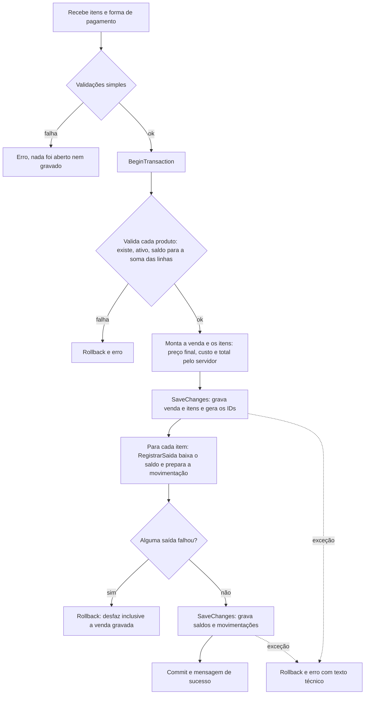
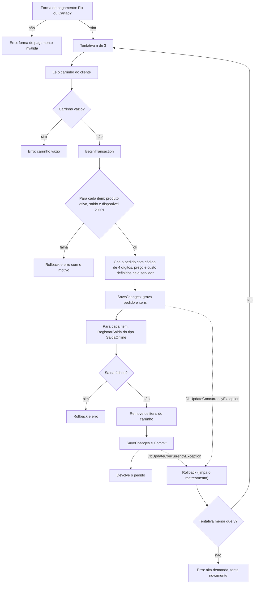
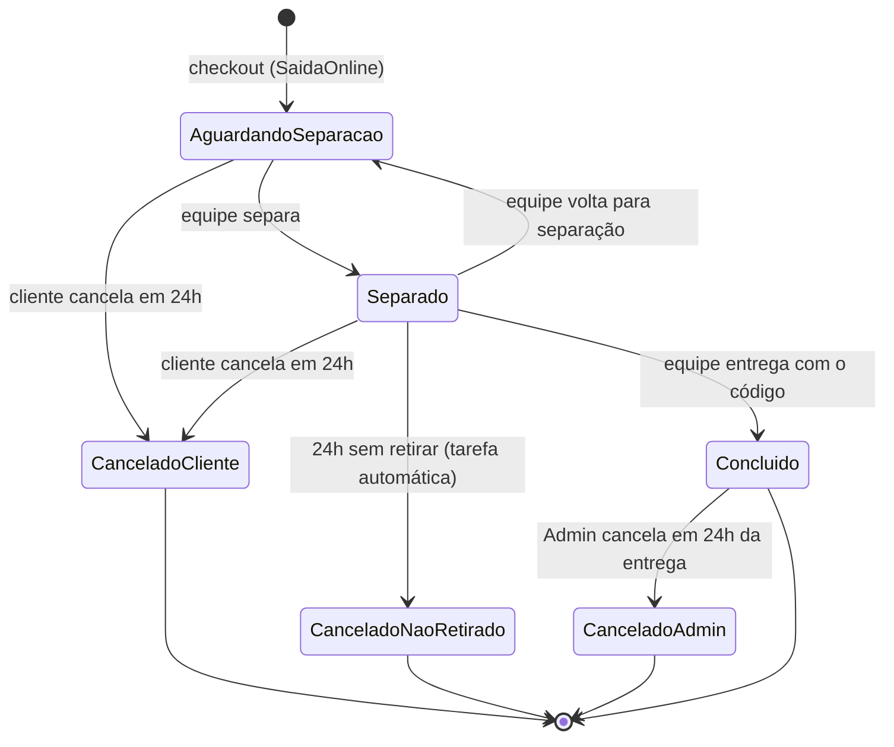
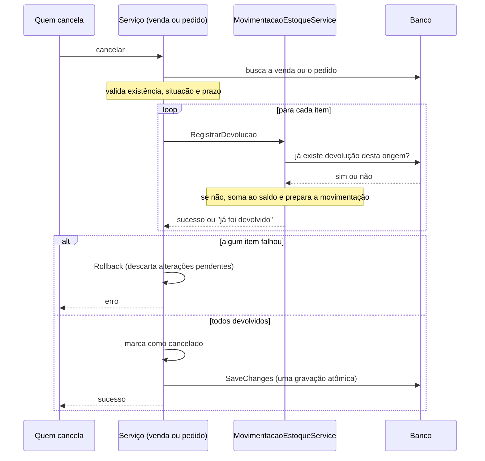
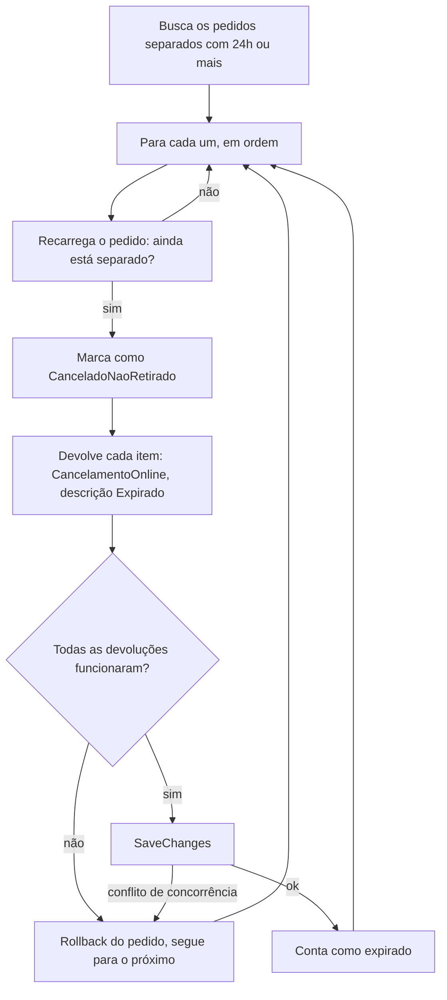
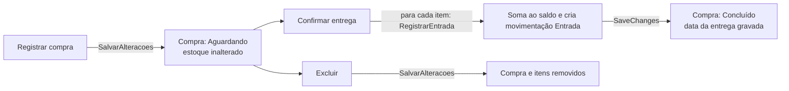
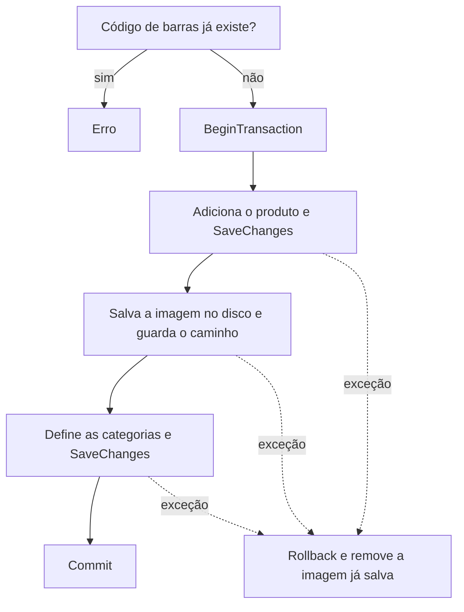

# Fluxos principais

Este documento responde: **o que acontece, passo a passo e dentro do código, nas operações que mexem no estoque e no dinheiro**, e o que fica gravado se uma delas falhar no meio. Os casos de uso (o que a pessoa faz) estão em [07-casos-de-uso](07-casos-de-uso.md); as transações e o `UnitOfWork`, em [04-comunicacao-com-o-banco](04-comunicacao-com-o-banco.md).

## Sumário

1. [O padrão comum](#1-o-padrão-comum)
2. [Movimentações: os seis tipos](#2-movimentações-os-seis-tipos)
3. [Venda no balcão](#3-venda-no-balcão)
4. [Checkout da loja online](#4-checkout-da-loja-online)
5. [Ciclo de vida do pedido online](#5-ciclo-de-vida-do-pedido-online)
6. [Cancelamentos e devoluções](#6-cancelamentos-e-devoluções)
7. [Expiração automática](#7-expiração-automática)
8. [Compra e entrada de estoque](#8-compra-e-entrada-de-estoque)
9. [Ajuste de estoque e cadastro de produto](#9-ajuste-de-estoque-e-cadastro-de-produto)
10. [Resumo: o que cada fluxo grava](#10-resumo-o-que-cada-fluxo-grava)
11. [Limitações](#11-limitações)

---

## 1. O padrão comum

Quase todos os fluxos que alteram estoque seguem a mesma ordem, e entender esse esqueleto facilita ler cada um:

1. **Validar** tudo o que dá para validar sem gravar (quantidades, situação do produto, saldo, prazos).
2. **Preparar** as alterações no contexto: a venda ou o pedido com seus itens, a mudança de status.
3. **Mudar o estoque** pelo único caminho permitido, o `IMovimentacaoEstoqueService`: ele altera o saldo do produto e cria a movimentação correspondente, sem gravar.
4. **Gravar** (`SaveChanges`) e **confirmar** (`Commit`), ou **desfazer** (`Rollback`) se algo falhou.

O ponto central: o serviço de vendas, de compras ou de pedidos **nunca altera o saldo diretamente**. Ele pede ao serviço de estoque, e esse é o único lugar onde o saldo muda (regra de arquitetura R3). Por isso toda variação de saldo tem uma movimentação, com origem e responsável.

## 2. Movimentações: os seis tipos

| Tipo | Quando | Efeito no saldo | Origem gravada | Quem registra | Responsável |
|---|---|---|---|---|---|
| `Entrada` | Compra confirmada | Soma | Item da compra | `RegistrarEntrada` | Quem confirmou |
| `Saida` | Venda no balcão | Subtrai | Item da venda | `RegistrarSaida` | Quem vendeu |
| `SaidaOnline` | Checkout | Subtrai | Item do pedido | `RegistrarSaida` | Nenhum (é o cliente) |
| `Cancelamento` | Venda cancelada | Soma | Item da venda | `RegistrarDevolucao` | Quem cancelou |
| `CancelamentoOnline` | Pedido cancelado ou expirado | Soma | Item do pedido | `RegistrarDevolucao` | O Admin (cancelamento após a entrega); nenhum quando o cliente cancela ou na expiração (a descrição registra "Cancelado pelo cliente" ou "Expirado") |
| `Edicao` | Ajuste de estoque | Define o novo saldo | Nenhuma (tem descrição) | `AjustarEstoque` | O Admin |

Regras das operações:

- **Quantidade sempre positiva** nas saídas, entradas e devoluções (o tipo diz o sentido); no `Edicao`, a quantidade registrada é a **diferença** (pode ser negativa).
- `RegistrarSaida` recusa saldo insuficiente.
- `RegistrarDevolucao` exige **exatamente uma origem** (item de venda **ou** item de pedido) e consulta o banco para saber se aquela origem já foi devolvida; se já foi: "Este item já foi devolvido ao estoque." É isso que impede devolver duas vezes.
- As três operações **só preparam** a alteração. Quem as chamou grava junto com o resto da operação.

---

## 3. Venda no balcão

`VendaService.FinalizarVenda`, chamado por `VendaController.FinalizarVenda`.

**Por que gravar duas vezes.** A movimentação aponta para o identificador do item da venda (`ItemVendaID`), que só existe depois do primeiro `SaveChanges`. Como tudo está dentro de uma única transação, a venda gravada no passo 1 só vira definitiva no `Commit`.

**Linhas repetidas do mesmo produto.** A validação soma as quantidades por produto antes de comparar com o saldo (a soma é feita em `long`, o que evita estouro). Vender 3 + 4 unidades de um produto com saldo 5 é recusado, mesmo que cada linha caiba sozinha.

**O que fica gravado se falhar**

| Onde falha | Resultado |
|---|---|
| Validação simples (itens, pagamento, quantidade) | Nada gravado; nem transação foi aberta |
| Validação por produto | Nada gravado |
| Depois do primeiro `SaveChanges` (saída recusada ou exceção) | `Rollback`: a venda e os itens gravados são desfeitos |
| Conflito de concorrência no segundo `SaveChanges` | Cai na captura geral: `Rollback` e mensagem de erro; **sem nova tentativa** |

Os testes `VendaRollbackIntegracaoTests` exercitam esse desfazer em banco real.

---

## 4. Checkout da loja online

`PedidoService.Checkout`, chamado por `PedidoController.Checkout`. O desenho é igual ao da venda, com três diferenças: lê o carrinho, usa `SaidaOnline` sem responsável e **repete a tentativa** em caso de conflito de concorrência.

**Por que repetir.** Se outro cliente (ou o balcão) comprou o mesmo produto no intervalo, o `RowVersion` do produto não confere e a gravação falha. Na nova tentativa, o `Rollback` já limpou o rastreamento, então o saldo é lido de novo do banco; se o saldo atual não comporta o pedido, o erro passa a ser "Estoque insuficiente" ou o de disponibilidade, e a tentativa termina com uma mensagem clara.

**Código de retirada.** `GerarCodigoUnico` sorteia 4 dígitos (0000 a 9999) e repete o sorteio enquanto existir pedido **em andamento** (aguardando separação ou separado) com o mesmo código. Pedidos já encerrados liberam o código. Com muitos pedidos em andamento o sorteio pode demorar, pois o espaço é de apenas 10.000 códigos.

**Verificações de saldo.** Cada item passa por duas: o saldo total precisa cobrir a quantidade ("Estoque insuficiente para: X") e a quantidade precisa caber no disponível online, que é o saldo menos o estoque mínimo ("Apenas n unidade(s)..." ou "X apenas na loja física.").

**Falhas.** Qualquer erro dentro da transação desfaz tudo; o carrinho só é esvaziado no mesmo `SaveChanges` que confirma o pedido, então um checkout que falhou deixa o carrinho intacto. O retry do checkout **não** tem teste de integração.

---

## 5. Ciclo de vida do pedido online

| Transição | Quem | Condição | Estoque |
|---|---|---|---|
| (novo) → AguardandoSeparacao | Cliente | Checkout válido | Saída (`SaidaOnline`) |
| AguardandoSeparacao → Separado | Equipe | Status é aguardando | Não muda. Grava data e responsável |
| Separado → AguardandoSeparacao | Equipe | Status é separado | Não muda. Apaga data e responsável |
| Separado → Concluido | Equipe | Status é separado e código confere | Não muda. Grava data e responsável |
| AguardandoSeparacao ou Separado → CanceladoCliente | Cliente | Até 24h da **criação** | Devolução (`CancelamentoOnline`) |
| Separado → CanceladoNaoRetirado | Sistema | 24h ou mais desde a **separação** | Devolução (`CancelamentoOnline`, "Expirado") |
| Concluido → CanceladoAdmin | Admin | Até 24h da **entrega** | Devolução (`CancelamentoOnline`) |

Estados finais: `Concluido` (a menos do cancelamento do Admin), `CanceladoCliente`, `CanceladoNaoRetirado` e `CanceladoAdmin`. Pedidos concluídos e `CanceladoNaoRetirado` entram no faturamento do dashboard.

---

## 6. Cancelamentos e devoluções

Os três cancelamentos manuais seguem o mesmo roteiro: **conferir prazo e situação, devolver cada item, marcar o registro como cancelado e gravar uma única vez**.

| | Cancelar venda | Cancelar pelo cliente | Cancelar após a entrega |
|---|---|---|---|
| Serviço | `VendaService.CancelarVenda` | `PedidoService.CancelarPeloCliente` | `PedidoService.CancelarAposEntrega` |
| Quem | Admin | Cliente dono do pedido | Admin |
| Prazo | 24h da venda | 24h da criação do pedido | 24h da entrega |
| Situação exigida | Não cancelada | Aguardando separação ou separado | Concluído |
| Tipo da devolução | `Cancelamento` | `CancelamentoOnline` | `CancelamentoOnline` |
| Novo estado | `VendaCancelada = true` | `CanceladoCliente` | `CanceladoAdmin` |

**Por que não há transação explícita.** Todas as alterações (saldos, movimentações e o novo estado) ficam pendentes no contexto e saem num único `SaveChanges`, que o banco executa como uma operação atômica. Se uma devolução é recusada no meio, o `Rollback` do `UnitOfWork` (que limpa o rastreamento) descarta as alterações pendentes e nada chega ao banco.

**Cancelar duas vezes.** A segunda tentativa é barrada por duas camadas: a verificação de estado ("Venda já está cancelada", "Este pedido não pode mais ser cancelado") e, se esta for contornada, a verificação de origem da devolução ("Este item já foi devolvido ao estoque."). Há testes de repetição para os dois cenários.

---

## 7. Expiração automática

`ExpiracaoPedidosJob` acorda a cada 15 minutos e chama `PedidoService.ExpirarPedidosNaoRetirados`.

- A tarefa cria **um escopo novo a cada rodada** (e portanto um contexto de banco novo), porque um serviço em segundo plano é único e longevo, enquanto o contexto deve viver pouco.
- Cada pedido é processado e gravado **separadamente**: um conflito ou erro num pedido não impede os outros, e o pedido ignorado é tentado de novo na próxima rodada.
- Uma exceção que escape da rodada é capturada, registrada no console, e a tarefa continua.
- O prazo conta da **separação** (`PedidoDataSeparado`), e não da criação do pedido.

---

## 8. Compra e entrada de estoque

Dois passos separados, em momentos diferentes.

- **Registrar compra** cria a compra como "Aguardando" e o serviço descarta, sem avisar, as linhas inválidas (produto vazio, quantidade ou preço menores ou iguais a zero); a tela já valida isso antes. Só dá erro se não sobrar nenhum item.
- **Confirmar entrega** repete para cada item a entrada de estoque e então marca "Concluído". Confirmar uma compra já concluída não repete nada e termina sem erro, o que dá segurança contra clique duplo.
- **Excluir** só vale para compra não concluída; compra concluída é histórico e não pode ser removida.

---

## 9. Ajuste de estoque e cadastro de produto

**Ajuste de estoque (`AjustarEstoque`).** Não passa pelos métodos `Registrar*`: grava direto uma movimentação `Edicao` com a diferença para o saldo atual e o novo saldo, num único `SaveChanges`. Se a quantidade informada é igual à atual, nada é criado.

**Cadastro de produto (`CadastrarProduto`).** Usa transação porque envolve banco e arquivo:

O motivo da compensação no disco é que o `Rollback` desfaz o banco, mas não um arquivo já gravado. Detalhes e limitações da imagem estão no [doc 04](04-comunicacao-com-o-banco.md#8-imagens-o-banco-e-o-disco).

---

## 10. Resumo: o que cada fluxo grava

| Fluxo | Transação explícita | `SaveChanges` | Tabelas alteradas |
|---|:-:|:-:|---|
| Venda no balcão | Sim | 2 | Vendas, ItensVenda, Produtos, MovimentacoesEstoque |
| Checkout | Sim (até 3 tentativas) | 2 | Pedidos, ItensPedido, Produtos, MovimentacoesEstoque, CarrinhoItens |
| Cancelar venda | Não | 1 | Vendas, Produtos, MovimentacoesEstoque |
| Cancelar pedido (cliente ou após entrega) | Não | 1 | Pedidos, Produtos, MovimentacoesEstoque |
| Expirar pedido | Não (um `SaveChanges` por pedido) | 1 por pedido | Pedidos, Produtos, MovimentacoesEstoque |
| Separar, voltar, entregar pedido | Não | 1 | Pedidos |
| Registrar compra | Não | 1 | ComprasEstoque, ItensCompra |
| Confirmar entrega da compra | Não | 1 | ComprasEstoque, Produtos, MovimentacoesEstoque |
| Excluir compra | Não | 1 | ComprasEstoque, ItensCompra |
| Ajustar estoque | Não | 1 | Produtos, MovimentacoesEstoque |
| Cadastrar produto | Sim | 2 | Produtos, ProdutoCategorias (e um arquivo em disco) |

## 11. Limitações

- **A venda não tenta de novo em conflito de concorrência**, ao contrário do checkout (a equipe refaz a venda).
- **Mensagem técnica na falha.** O texto da exceção é devolvido ao usuário em `FinalizarVenda` e `Checkout` ("Erro ao salvar venda: ..."; "Erro ao processar pedido: ...").
- **Código de retirada de 4 dígitos**, sorteado e verificado só entre pedidos em andamento: o espaço é pequeno e não há limite de tentativas para o funcionário digitar códigos na entrega.
- **Sem notificação ao cliente.** O sistema não avisa quando o pedido é separado nem quando vai expirar.
- **A saída do estoque acontece no checkout**, não na retirada. O produto some do estoque assim que o cliente finaliza, mesmo que nunca retire (a devolução só acontece pelo cancelamento ou pela expiração).
- **Ajuste de estoque fora do caminho `Registrar*`.** É coerente com a regra (o próprio módulo de Estoque o executa), mas é a única alteração de saldo que não passa por esses métodos.
- **Sem teste de integração** para o retry de concorrência do checkout nem para os cancelamentos em banco real (há testes de serviço com dependências simuladas).
