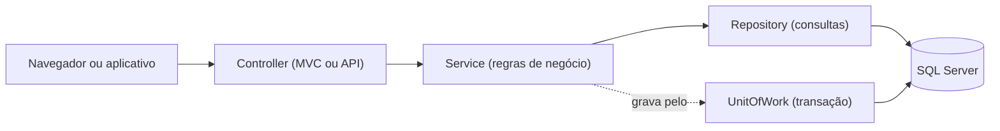
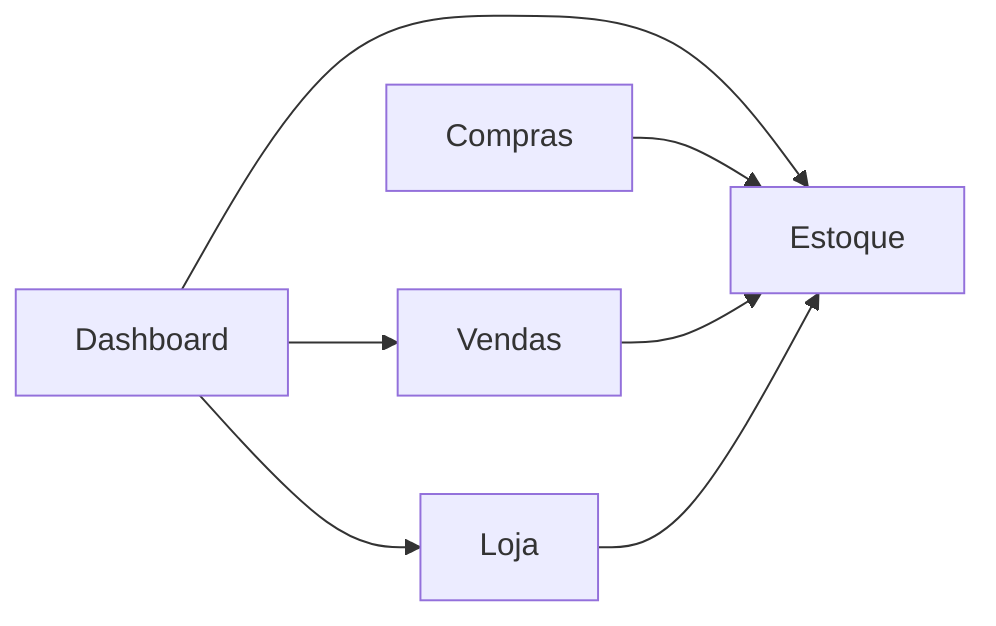

<<<<<<< HEAD
# PolarDrinks

Sistema de gestão para uma loja de bebidas, com duas frentes no mesmo projeto:

- **Área administrativa** (telas web com login): vendas no balcão, estoque, compras, fornecedores, pedidos online, usuários e um dashboard.
- **Loja online** (telas web e API REST): catálogo, carrinho, conta do cliente e pedidos com retirada na loja.

É um **monólito em camadas organizado por módulos**: um único projeto e um único banco de dados, mas com o código separado por assunto de negócio (Estoque, Vendas, Compras, Loja...) e, dentro de cada assunto, por camada (Controller → Service → Repository).

---

## Sumário

1. [Funcionalidades](#funcionalidades)
2. [Arquitetura](#arquitetura)
3. [Estrutura de pastas](#estrutura-de-pastas)
4. [Tecnologias](#tecnologias)
5. [Como executar](#como-executar)
6. [Configuração](#configuração)
7. [Como rodar os testes](#como-rodar-os-testes)
8. [Documentação](#documentação)
9. [Limitações conhecidas](#limitações-conhecidas)

---

## Funcionalidades

### Área administrativa

| Área | O que faz |
|---|---|
| **Vendas (balcão)** | Nova venda com pagamento em dinheiro, Pix ou cartão; histórico; detalhes; cancelamento com motivo em até 24 horas |
| **Estoque** | Cadastro e edição de produtos (com imagem e categorias), promoção pela edição rápida, ajuste de estoque com justificativa e tela de movimentações, e relatório de reposição em PDF |
| **Categorias** | Cadastro e edição de categorias de produtos |
| **Compras e fornecedores** | Registro de compras, confirmação de entrega (que dá entrada no estoque), exclusão de compras pendentes e cadastro de fornecedores |
| **Pedidos online** | Separar o pedido, confirmar a entrega com o código de retirada, cancelar após a entrega e consultar o histórico |
| **Usuários** | Cadastro, desativação e troca de senha, com perfis **Admin** e **Funcionário** |
| **Dashboard** | Faturamento, lucro e ticket médio, formas de pagamento, alertas de estoque, giro, produtos mais vendidos, previsão de vendas, gráficos e cancelamentos, e relatório de vendas por período e canal em PDF |

Alguns recursos são exclusivos do perfil **Admin** (como o dashboard, os usuários, as compras e as categorias). O detalhamento por perfil está no [mapa de responsabilidades](docs/entrega/MAPA-DE-RESPONSABILIDADES.md).

### Loja online

- Catálogo de produtos com promoções (o preço promocional exibido no catálogo é uma estimativa; o carrinho e o checkout usam sempre o preço calculado pelo servidor).
- Cadastro e login do cliente (autenticação por **JWT**).
- Carrinho e **checkout** com pagamento em Pix ou cartão.
- Cada pedido recebe um **código de retirada**; o cliente acompanha seus pedidos no perfil e pode cancelar em até 24 horas.
- Pedidos separados e **não retirados em 24 horas expiram sozinhos**, e o estoque volta (uma tarefa em segundo plano verifica a cada 15 minutos).

---

## Arquitetura

O projeto combina **três ideias** que se complementam:

- **MVC:** as telas são Controllers + Views Razor; a loja também expõe uma API REST.
- **Camadas:** Controller (recebe a requisição) → Service (regras de negócio) → Repository (consultas) → banco.
- **Módulos:** cada assunto de negócio mora em sua própria pasta, com as próprias camadas.



### Os módulos e quem depende de quem



- O **Estoque** é o dono do **saldo dos produtos** e do **preço final**: Vendas, Compras e Loja pedem a ele a saída, a devolução ou a entrada de mercadoria, e nenhum deles altera o saldo por conta própria.
- O **Dashboard** só lê dados de Estoque, Vendas e Loja.
- O módulo **Usuarios** não depende de ninguém (os outros apenas guardam quem executou cada operação).
- O **Compartilhado** reúne o que é comum a todos (resultado de operações, transações, filtros de login).
- **Essas regras são verificadas por testes automáticos** (veja [Como rodar os testes](#como-rodar-os-testes)): se alguém quebrar um limite entre módulos, um teste fica vermelho.

---

## Estrutura de pastas

```
PolarDrink-v2/
├── PolarDrinks/                       aplicação (telas web e API)
│   ├── Program.cs                     configuração e injeção de dependências
│   ├── Modules/
│   │   ├── Usuarios/                  login, logout e gestão de usuários
│   │   ├── Estoque/                   produtos, categorias, movimentações e imagens
│   │   ├── Compras/                   compras e fornecedores
│   │   ├── Vendas/                    vendas no balcão
│   │   ├── Dashboard/                 indicadores e previsões
│   │   └── Loja/                      loja online, pedidos, API REST e tarefa de expiração
│   │       (cada módulo tem: Controllers, Services, Repositories, Models e Views)
│   ├── Compartilhado/                 Common, Controllers (Home), Filters, Models, Mvc, Repositories
│   ├── Data/                          ApplicationDbContext (mapeamento do banco)
│   ├── Migrations/                    histórico de alterações do banco
│   ├── Views/                         telas compartilhadas (Home e layouts)
│   ├── wwwroot/                       CSS, JavaScript, imagens e bibliotecas
│   ├── appsettings.json               configuração
│   └── Dockerfile
├── PolarDrinks.Tests/                 testes (organizados por módulo)
│   ├── Vendas/  Estoque/  Compras/  Dashboard/  Loja/
│   ├── Integracao/                    testes com banco SQL Server de verdade
│   └── Arquitetura/                   regras de arquitetura
├── docs/                              documentação
│   └── banco/PolarDrinks.sql          script completo do banco (tabelas, triggers e procedures)
├── docker-compose.yml                 aplicação + SQL Server em contêineres
└── README.md
```

As telas de cada módulo ficam **dentro do módulo** (`Modules/<Modulo>/Views/<Controller>/`). Para o MVC achá-las ali, existe uma classe própria, o `ModuloViewLocationExpander` (em `Compartilhado/Mvc`), registrada no `Program.cs`.

---

## Tecnologias

| Para quê | O que |
|---|---|
| Plataforma | **.NET 10**, ASP.NET Core MVC (Razor) e API REST no mesmo projeto |
| Banco de dados | **SQL Server**, acessado com **Entity Framework Core 10** (migrations aplicadas ao iniciar) |
| Login do administrativo | Sessão no servidor (30 minutos de inatividade) e senhas protegidas com **BCrypt** |
| Login do cliente da loja | **JWT** |
| Testes | **xUnit** e **NSubstitute** |
| Contêineres | **Docker** e **Docker Compose** |

---

## Como executar

### Opção A: com SQL Server instalado no computador

**Pré-requisitos:** SDK do **.NET 10** e um SQL Server acessível como `.` (instância local) com a autenticação do Windows.

Na raiz do repositório:

```bash
dotnet run --project PolarDrinks
```

O sistema abre em **http://localhost:5153**. Na primeira execução ele **cria o banco `PolaDrinks`**, aplica as migrations e cadastra um usuário inicial:

| Login | Senha | Perfil |
|---|---|---|
| `admin` | `admin123` | Admin |

> **Troque essa senha** assim que entrar (veja [Limitações conhecidas](#limitações-conhecidas)).

Para usar outro servidor, altere `ConnectionStrings:DefaultConnection` (veja [Configuração](#configuração)).

### Opção B: com Docker

**Pré-requisito:** Docker com Docker Compose. Na raiz do repositório:

```bash
docker compose up -d --build
```

Isso sobe a aplicação em **http://localhost:8080** e um SQL Server 2022 na porta 1433, com os dados guardados no volume `polardrinks-db-data`. O banco e o usuário inicial são criados do mesmo jeito.

```bash
docker compose down        # para os contêineres e mantém os dados
docker compose down -v     # para e APAGA os dados do banco
```

### Criar uma nova migration do banco

A ferramenta `dotnet-ef` está registrada no projeto. Dentro da pasta `PolarDrinks`:

```bash
dotnet tool restore
dotnet ef migrations add NomeDaMigration
```

---

## Configuração

Chaves do arquivo `PolarDrinks/appsettings.json`:

| Chave | Para quê |
|---|---|
| `ConnectionStrings:DefaultConnection` | Conexão com o SQL Server |
| `Jwt:ChaveSecreta` | Chave que assina os tokens da loja online |
| `Jwt:Emissor` | Emissor dos tokens |
| `Jwt:DuracaoEmHoras` | Validade do token do cliente |

Qualquer chave pode ser substituída por uma **variável de ambiente**, trocando `:` por `__` (por exemplo, `ConnectionStrings__DefaultConnection`, como faz o `docker-compose.yml`). Em produção, prefira sempre variáveis de ambiente ou um cofre de segredos, em vez de escrever valores no arquivo.

---

## Como rodar os testes


```bash
dotnet test PolarDrinks/PolarDrinks.sln                                       # todos os testes
dotnet test PolarDrinks/PolarDrinks.sln --filter "Categoria=Arquitetura"      # só as regras de arquitetura
dotnet test PolarDrinks/PolarDrinks.sln --filter "Categoria=Integracao"       # só os testes com banco real
dotnet test PolarDrinks/PolarDrinks.sln --filter "Categoria!=Integracao"      # tudo, menos os que precisam do SQL Server
```

Os testes são de três tipos:

| Tipo | O que verifica | Precisa de SQL Server? |
|---|---|---|
| **Unitários** | Regras de venda, estoque, preço, compras, pedidos e dashboard, com repositórios simulados | Não |
| **Integração** | Que uma operação que falha no meio **desfaz tudo** no banco de verdade (venda, cadastro de produto) | Sim |
| **Arquitetura** | Os limites entre módulos, camadas e namespaces, lendo o código-fonte | Não |

Os testes de **integração** criam um banco temporário (`PolaDrinks_Testes_<código>`) no mesmo servidor, com as migrations reais, e o **apagam ao final**: o banco `PolaDrinks` do dia a dia nunca é tocado. Se o SQL Server não estiver acessível, esses testes são **ignorados com um aviso** em vez de falharem. Para usar outro servidor, defina a variável de ambiente `POLARDRINKS_TESTES_CONEXAO` com a conexão **sem o nome do banco** (por padrão: `Server=.;Trusted_Connection=True;TrustServerCertificate=True;`).

Os resultados e a lista dos cenários cobertos estão em [docs/entrega/RESULTADOS-DOS-TESTES.md](docs/entrega/RESULTADOS-DOS-TESTES.md).

---

## Documentação

| Documento | Conteúdo |
|---|---|
| [01 — Visão e requisitos](docs/01-visao-e-requisitos.md) | Objetivos, escopo e requisitos do sistema |
| [02 — Arquitetura](docs/02-arquitetura.md) | Estrutura da aplicação e decisões arquiteturais |
| [03 — Modelo de dados](docs/03-modelo-de-dados.md) | Entidades, relacionamentos e persistência |
| [04 — Comunicação com o banco](docs/04-comunicacao-com-o-banco.md) | Acesso ao banco de dados e migrations |
| [05 — API](docs/05-api.md) | Endpoints, contratos e exemplos de uso |
| [06 — Autenticação e permissões](docs/06-autenticacao-e-permissoes.md) | Login, sessão e controle de acesso |
| [07 — Casos de uso](docs/07-casos-de-uso.md) | Atores e funcionalidades do sistema |
| [08 — Fluxos principais](docs/08-fluxos-principais.md) | Passos dos principais processos |
| [09 — Módulos](docs/09-modulos.md) | Responsabilidades e organização dos módulos |
| [10 — Guia de testes](docs/10-guia-de-testes.md) | Como executar e interpretar os testes |
| [11 — Como evoluir o projeto](docs/11-como-evoluir-o-projeto.md) | Orientações para mudanças futuras |
| [Apresentação](docs/entrega/APRESENTACAO.md) | Roteiro de apresentação do projeto |
| [Mapa de responsabilidades](docs/entrega/MAPA-DE-RESPONSABILIDADES.md) | Quem é dono de quê (preço, estoque), dependências permitidas entre módulos, contratos e o que acontece quando uma operação falha |
| [Registro das alterações](docs/entrega/REGISTRO-DE-ALTERACOES.md) | Cada problema encontrado na análise, a solução, os arquivos e a evidência |
| [Resultados dos testes](docs/entrega/RESULTADOS-DOS-TESTES.md) | Comandos, ambiente e cenários cobertos |

---

## Limitações conhecidas

Registradas aqui para que ninguém as descubra por acidente:

1. **Segredos no repositório.** A chave `Jwt:ChaveSecreta` (`appsettings.json`), a senha do SQL Server do `docker-compose.yml` e o usuário inicial `admin`/`admin123` (`Program.cs`) são valores de desenvolvimento. **Em produção, troque todos** e leia os segredos de variáveis de ambiente.
2. **O dashboard ainda carrega o histórico** de vendas e pedidos para os gráficos, rankings e previsões. O resumo financeiro e as contagens de estoque já são calculados no banco, mas o restante pode ficar lento quando o volume de dados crescer.
3. **A previsão de vendas usa só os dias com movimento:** dias sem venda não entram como zero na tendência.
4. **Envio de imagens sem limite de tamanho** (somente administradores enviam). O nome do arquivo é gerado pelo servidor e só formatos de imagem são aceitos.
5. **Leitura de produtos fora do Estoque.** Só o Estoque altera o saldo (isso é verificado por teste), mas Vendas, Compras e Loja ainda leem produtos pelo repositório do Estoque, em vez de por um contrato de consulta próprio.
6. **A página de erro de produção exige login:** como a `HomeController` usa o filtro de autenticação, quem não tem sessão é enviado ao login em vez de ver a página de erro.
7. **Concorrência no checkout:** o tratamento de conflito de `RowVersion` com nova tentativa existe, mas não tem teste de integração.
8. **Preço promocional do catálogo calculado no navegador.** O valor cobrado é sempre o do servidor; em casos raros de arredondamento, o centavo exibido no catálogo pode diferir do cobrado.
=======
# Polar Drinks

João Paasou aqui Minha branch sai pra la
>>>>>>> fea36515a8c3178b248b55290ae0f2d527c812a9
