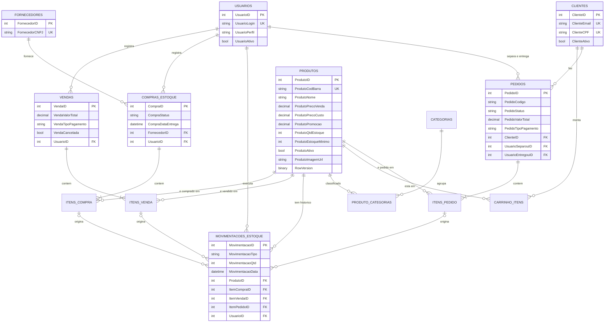
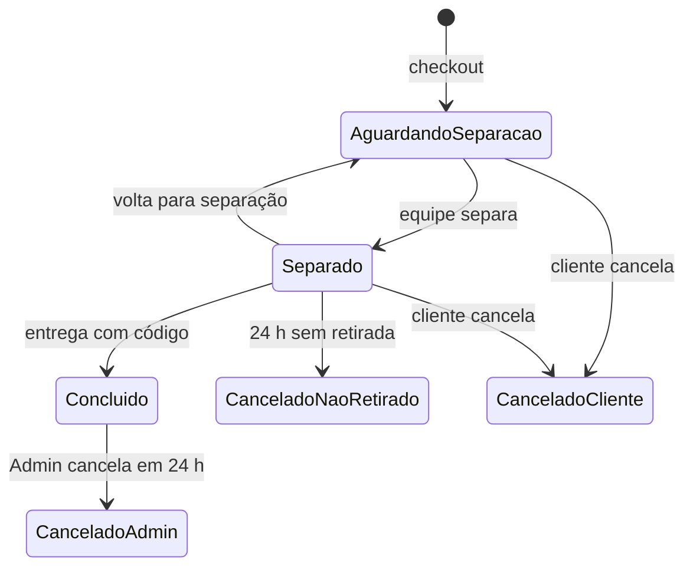

# Modelo de dados

Este documento responde: **quais tabelas existem, como se relacionam, o que o banco garante sozinho e o que depende do código**. A fonte é o `ApplicationDbContext` e o histórico em `Migrations/`.

## Sumário

1. [Visão geral](#1-visão-geral)
2. [Diagrama de relacionamentos](#2-diagrama-de-relacionamentos)
3. [Tabelas por módulo](#3-tabelas-por-módulo)
4. [Relacionamentos e exclusão](#4-relacionamentos-e-exclusão)
5. [O que o banco garante e o que só o código garante](#5-o-que-o-banco-garante-e-o-que-só-o-código-garante)
6. [Valores controlados](#6-valores-controlados)
7. [Tipos e convenções](#7-tipos-e-convenções)
8. [Migrations](#8-migrations)
9. [Dados iniciais](#9-dados-iniciais)
10. [Limitações do modelo](#10-limitações-do-modelo)
11. [Triggers, procedures e script do banco](#11-triggers-procedures-e-script-do-banco)

---

## 1. Visão geral

| Item | Valor |
|---|---|
| Banco | SQL Server |
| Nome do banco | `PolaDrinks` (cadeia `DefaultConnection`) |
| Acesso | Entity Framework Core 10, por um único `ApplicationDbContext` |
| Tabelas | 14 |
| Convenção de nomes | Cada tabela tem prefixo do assunto e a chave termina em `ID` (`ProdutoID`, `VendaID`...); colunas seguem `<Entidade><Campo>` (`ProdutoPrecoVenda`) |

O mapeamento é um só, mas cada tabela pertence a um módulo, que é o único autorizado a gravar nela (veja a seção 3).

## 2. Diagrama de relacionamentos



> Os nomes das tabelas no diagrama usam sublinhado só por limitação da notação (`COMPRAS_ESTOQUE`). No banco elas se chamam `ComprasEstoque`, `ItensCompra`, `ItensVenda`, `MovimentacoesEstoque`, `ProdutoCategorias`, `CarrinhoItens` e `ItensPedido`.

Para não poluir o desenho, os atributos aparecem só nas tabelas centrais. As demais (`Itens*`, `Categorias`, `ProdutoCategorias`, `CarrinhoItens`) seguem a mesma convenção e estão descritas na seção 3.

## 3. Tabelas por módulo

Quem **grava** em cada tabela é o módulo indicado. Outros módulos podem apenas ler (ou, no caso da movimentação, pedir a gravação ao Estoque).

| Módulo | Tabela | O que guarda | Colunas principais |
|---|---|---|---|
| Usuarios | `Usuarios` | Equipe com acesso ao sistema | `UsuarioLogin` (único), `UsuarioSenhaHash`, `UsuarioPerfil`, `UsuarioAtivo`, `UsuarioCriadoEm` |
| Estoque | `Produtos` | Catálogo e saldo | `ProdutoCodBarra` (único), preços, `ProdutoPromocao`, `ProdutoQtdEstoque`, `ProdutoEstoqueMinimo`, `ProdutoAtivo`, `ProdutoImagemUrl`, `RowVersion` |
| Estoque | `Categorias` | Categorias de produtos | `CategoriaNome`, `CategoriaAtiva` |
| Estoque | `ProdutoCategorias` | Liga produto a categoria (N para N) | Chave composta `ProdutoID` + `CategoriaID` |
| Estoque | `MovimentacoesEstoque` | Histórico de toda mudança de saldo | `MovimentacaoTipo`, `MovimentacaoQtd`, `MovimentacaoDescricao`, `MovimentacaoData`, origem (`ItemCompraID`, `ItemVendaID` ou `ItemPedidoID`), `UsuarioID` |
| Compras | `Fornecedores` | Fornecedores | `FornecedorCNPJ` (único), contato e endereço completo, `FornecedorAtivo` |
| Compras | `ComprasEstoque` | Compra de mercadoria | `CompraStatus`, `CompraData`, `CompraDataEntrega`, `FornecedorID`, `UsuarioID` |
| Compras | `ItensCompra` | Itens de uma compra | `ItemCompraQtd`, `ItemCompraPreco`, `ProdutoID`, `CompraID` |
| Vendas | `Vendas` | Venda no balcão | `VendaValorTotal`, `VendaTipoPagamento`, `VendaData`, `VendaCancelada`, `UsuarioID` |
| Vendas | `ItensVenda` | Itens de uma venda | `ItemVendaQtd`, `ItemVendaPreco`, `ItemVendaCusto`, `ProdutoID`, `VendaID` |
| Loja | `Clientes` | Contas da loja online | `ClienteEmail` e `ClienteCPF` (únicos), `ClienteSenhaHash`, `ClienteAtivo` |
| Loja | `CarrinhoItens` | Carrinho salvo de cada cliente | `ClienteID`, `ProdutoID`, `Quantidade`, `AdicionadoEm` |
| Loja | `Pedidos` | Pedido online | `PedidoCodigo`, `PedidoStatus`, `PedidoValorTotal`, `PedidoTipoPagamento`, datas de separação e conclusão, quem separou e quem entregou |
| Loja | `ItensPedido` | Itens de um pedido | `ItemPedidoQtd`, `ItemPedidoPreco`, `ItemPedidoCusto`, `ProdutoID`, `PedidoID` |

**Por que os itens guardam preço e custo.** `ItensVenda` e `ItensPedido` gravam o preço e o custo **do momento da venda**. Assim o histórico e o lucro continuam corretos mesmo que o produto mude de preço depois.

**Totais calculados.** `CompraValorTotal` (compra) e `ItemVendaTotal` (item de venda) não existem no banco: são propriedades calculadas pelo código (`[NotMapped]`).

## 4. Relacionamentos e exclusão

Comportamento de exclusão definido no mapeamento (confirmado no *snapshot* das migrations):

| Relacionamento | Ao excluir o pai |
|---|---|
| `ComprasEstoque` → `Fornecedores` | **Cascata** (exclui as compras) |
| `ItensCompra` → `ComprasEstoque` | **Cascata** |
| `ItensCompra` → `Produtos` | **Cascata** |
| `ItensVenda` → `Vendas` | **Cascata** |
| `ItensVenda` → `Produtos` | **Cascata** |
| `ItensPedido` → `Pedidos` | **Cascata** |
| `ItensPedido` → `Produtos` | Restrito (bloqueia) |
| `CarrinhoItens` → `Clientes` | **Cascata** |
| `CarrinhoItens` → `Produtos` | Restrito |
| `ProdutoCategorias` → `Produtos` e `Categorias` | **Cascata** |
| `MovimentacoesEstoque` → `Produtos` | **Cascata** |
| `MovimentacoesEstoque` → itens de compra, venda e pedido | Restrito |
| `Pedidos` → `Clientes` | Restrito |
| `Pedidos`, `Vendas`, `ComprasEstoque`, `MovimentacoesEstoque` → `Usuarios` | Restrito |

**Na prática, o sistema quase não exclui nada.** O código só remove itens de carrinho e compras que ainda não foram concluídas. Produtos, fornecedores, categorias, vendas e pedidos nunca são excluídos: são **desativados** (`ProdutoAtivo`, `FornecedorAtivo`, `CategoriaAtiva`, `UsuarioAtivo`, `ClienteAtivo`) ou **cancelados** (`VendaCancelada`, `PedidoStatus`). É isso que preserva o histórico; veja a limitação correspondente na seção 10.

## 5. O que o banco garante e o que só o código garante

### O banco garante

| Garantia | Onde |
|---|---|
| Código de barras único | Índice único em `Produtos.ProdutoCodBarra` |
| Login único | Índice único em `Usuarios.UsuarioLogin` |
| E-mail e CPF únicos | Índices únicos em `Clientes.ClienteEmail` e `Clientes.ClienteCPF` |
| CNPJ único | Índice único em `Fornecedores.FornecedorCNPJ` |
| Não repetir produto na mesma categoria | Chave composta de `ProdutoCategorias` |
| Integridade das chaves estrangeiras | Todas as relações da seção 4 |
| Tamanho máximo dos textos | Por exemplo, nome do produto com 100, código do pedido com 4 |
| Colunas obrigatórias | `NOT NULL` nas colunas sem `?` (quantidade e estoque mínimo do produto são obrigatórios no banco, mesmo sendo `int?` no código) |
| Precisão dos valores | `decimal(18,2)` para dinheiro e `decimal(5,2)` para promoção |
| Controle de concorrência | Coluna `RowVersion` em `Produtos` (se dois processos alterarem o mesmo produto, o segundo recebe um conflito) |
| Saldo nunca negativo | Trigger `TR_Produtos_ImpedirEstoqueNegativo` (o código também garante, em `RegistrarSaida`) |
| Sempre há pelo menos um administrador ativo | Trigger `TR_Usuarios_ProtegerUltimoAdmin` (o código também garante, em `UsuarioService.Desativar`) |

### Só o código garante

Estas regras **não têm** restrição no banco; dependem dos serviços:

| Regra | Quem garante |
|---|---|
| Devolver ao estoque uma única vez por item | `RegistrarDevolucao`, que consulta a movimentação existente (não há índice único) |
| Nome de categoria único | `CategoriaService` |
| Código de retirada do pedido não repetido entre pedidos ativos | `PedidoService.GerarCodigoUnico` (número de 4 dígitos; não há índice) |
| Valores válidos de status, tipo de pagamento, perfil e tipo de movimentação | Constantes no código (colunas de texto livre) |
| Quantidades positivas nos itens de venda | `VendaService.FinalizarVenda` |
| Promoção entre 0 e 100 | Anotação do modelo e `EdicaoRapida` |

## 6. Valores controlados

Várias colunas guardam texto, mas só aceitam um conjunto de valores definido em constantes do código:

| Coluna | Valores |
|---|---|
| `MovimentacaoTipo` | `Entrada`, `Saida`, `SaidaOnline`, `Edicao`, `Cancelamento`, `CancelamentoOnline` |
| `VendaTipoPagamento` | `Dinheiro`, `Pix`, `Cartão` |
| `PedidoTipoPagamento` | `Pix`, `Cartao` |
| `PedidoStatus` | `AguardandoSeparacao`, `Separado`, `Concluido`, `CanceladoCliente`, `CanceladoNaoRetirado`, `CanceladoAdmin` |
| `CompraStatus` | `Aguardando`, `Concluído` |
| `UsuarioPerfil` | `Admin`, `Funcionario` |

Ciclo de vida do pedido online:



Origem de cada movimentação de estoque:

| Tipo | Origem preenchida | Efeito no saldo |
|---|---|---|
| `Entrada` | `ItemCompraID` | soma |
| `Saida` | `ItemVendaID` | subtrai |
| `SaidaOnline` | `ItemPedidoID` | subtrai |
| `Cancelamento` | `ItemVendaID` | soma |
| `CancelamentoOnline` | `ItemPedidoID` | soma |
| `Edicao` | nenhuma (ajuste manual com justificativa) | soma ou subtrai a diferença |

## 7. Tipos e convenções

- **Dinheiro:** `decimal(18,2)`. A promoção é `decimal(5,2)` (percentual de 0 a 100).
- **Datas:** `DateTime` gravado com a hora **local** do servidor (`DateTime.Now`), sem fuso horário.
- **Textos:** `nvarchar` com tamanho máximo definido; `ProdutoImagemUrl` é `nvarchar(max)` e guarda o caminho do arquivo da imagem, não a imagem.
- **Chaves:** inteiros com identidade automática.
- **Senhas:** nunca em texto puro; `UsuarioSenhaHash` e `ClienteSenhaHash` guardam o hash BCrypt.

## 8. Migrations

As migrations ficam em `Migrations/` e são aplicadas **sozinhas ao iniciar a aplicação** (`Database.Migrate()` no `Program.cs`).

| Migration | O que fez |
|---|---|
| `inicial` | Criou as tabelas do núcleo: Fornecedores, Produtos, Usuarios, ComprasEstoque, Vendas, ItensCompra, ItensVenda e MovimentacoesEstoque |
| `IndiceUnicoCodigoBarras` | Tornou o código de barras do produto único |
| `RemoverColunaItemVendaTotal` | Removeu a coluna `ItemVendaTotal` (passou a ser calculada no código) |
| `AdicionarLojaOnline` | Criou Categorias, Clientes, ProdutoCategorias, CarrinhoItens, Pedidos e ItensPedido; adicionou `ProdutoImagemUrl`, `RowVersion` e `ItemPedidoID` na movimentação |
| `AdicionarTipoPagamentoPedido` | Adicionou `PedidoTipoPagamento` aos pedidos |
| `AdicionarTriggersEProcedures` | Criou as triggers `TR_Usuarios_ProtegerUltimoAdmin` e `TR_Produtos_ImpedirEstoqueNegativo` e as procedures `sp_ProdutosAbaixoDoMinimo` e `sp_ResumoVendasPorPeriodo` |
| `AdicionarProceduresOnlineEGeral` | Criou as procedures `sp_ResumoPedidosOnlinePorPeriodo` e `sp_ResumoGeralPorPeriodo` |

**Criar uma migration** (a ferramenta `dotnet-ef` está registrada no projeto; rode dentro da pasta `PolarDrinks`, a mesma do README):

```bash
dotnet tool restore
dotnet ef migrations add NomeDaMigration
```

Não é preciso rodar `dotnet ef database update`: a próxima execução da aplicação aplica a migration sozinha.

Regras de convivência: não editar migration já aplicada em outro ambiente e sempre gerar uma nova migration quando o modelo mudar.

> **Limpeza:** existia `Migrations/20260422170112_criandobd.cs`, um resíduo sem `.Designer.cs` que o Entity Framework ignorava. Ele foi removido sem alterar o banco.

## 9. Dados iniciais

Ao iniciar, se a tabela `Usuarios` estiver vazia, o `Program.cs` cria o usuário **Admin** (login `admin`, perfil Admin, ativo). Não há dados de demonstração de produtos, clientes ou vendas. A senha padrão deve ser trocada em qualquer ambiente real.

## 10. Limitações do modelo

- **Exclusão em cascata no histórico.** Excluir um produto diretamente no banco removeria também os itens de venda e de compra e as movimentações desse produto. O sistema nunca exclui produtos, mas o banco, por si só, não impede.
- **Garantias só no código.** Devolução única, nome de categoria único e código de retirada único não têm restrição no banco (seção 5). Uma gravação feita fora da aplicação poderia violá-las.
- **Texto livre em colunas de domínio fechado.** Status, perfil e tipos são `nvarchar`, sem `CHECK` ou tabela de apoio.
- **Datas sem fuso.** Servidores em fusos diferentes interpretariam os mesmos horários de forma diferente.
- **Telefone do cliente.** A coluna é obrigatória (`NOT NULL`), mas o serviço de cadastro não valida o telefone, então o campo pode ficar vazio (texto vazio, não nulo).
- **Sem exclusão lógica padronizada.** Cada tabela usa seu próprio indicador (`Ativo`, `Cancelada`, status), e vendas e compras não têm campo de "excluída".

## 11. Triggers, procedures e script do banco

Os objetos abaixo ficam no próprio SQL Server. São criados por migrations (`AdicionarTriggersEProcedures` e `AdicionarProceduresOnlineEGeral`), então nascem sozinhos em qualquer banco onde a aplicação rode (local, Docker ou nuvem) e também aparecem no script completo.

### Triggers

| Trigger | Tabela | Quando dispara | O que faz |
|---|---|---|---|
| `TR_Usuarios_ProtegerUltimoAdmin` | `Usuarios` | Depois de alterar | Desfaz a alteração (erro 50001) se ela deixar o sistema sem nenhum administrador ativo |
| `TR_Produtos_ImpedirEstoqueNegativo` | `Produtos` | Depois de inserir ou alterar | Desfaz a gravação (erro 50002) se algum produto ficar com estoque negativo |

As duas repetem, no banco, regras que o C# já garante. São uma segunda camada de proteção: valem também para alterações feitas fora do sistema, pelo SQL Server Management Studio ou por outro programa. Uma restrição `CHECK` não serviria para a primeira, porque ela precisa contar os administradores ativos em outras linhas da tabela.

**Cuidado com o Entity Framework.** Por padrão, o EF grava usando a cláusula `OUTPUT`, que o SQL Server não aceita em tabelas com trigger. Por isso o `ApplicationDbContext` declara as duas triggers com `HasTrigger`; sem essa declaração, toda gravação em `Usuarios` e `Produtos` falharia.

### Procedures

Todas são só de leitura (relatórios): não alteram dados e não competem com o Estoque como dono do saldo.

| Procedure | Parâmetros | Devolve | Usada por |
|---|---|---|---|
| `sp_ProdutosAbaixoDoMinimo` | nenhum | Produtos ativos com estoque igual ou abaixo do mínimo, com a quantidade que falta e o custo | Relatório de reposição (`Estoque/RelatorioReposicao`) |
| `sp_ResumoVendasPorPeriodo` | `@Inicio`, `@Fim` | Resumo das vendas do balcão: quantidade, faturamento, lucro, totais por forma de pagamento e cancelamentos | Relatório de vendas, canal Presencial |
| `sp_ResumoPedidosOnlinePorPeriodo` | `@Inicio`, `@Fim` | O mesmo resumo para os pedidos online: concluídos e expirados contam como venda; cancelados pelo cliente ou pelo Admin, como cancelamentos | Relatório de vendas, canal Online |
| `sp_ResumoGeralPorPeriodo` | `@Inicio`, `@Fim` | A soma das duas anteriores: executa as duas e soma os resultados, sem recalcular nada | Relatório de vendas, canal Geral |

A data fim é inclusiva. As três procedures de resumo devolvem as mesmas colunas e seguem as mesmas regras do dashboard, para os números baterem.

As procedures são chamadas pelos repositories (`ProdutoRepository.ObterParaReposicao` e `RelatorioRepository.ObterResumoPorPeriodo`) com `Database.SqlQuery`, passando as datas como parâmetros. Para testar direto no banco:

```sql
EXEC sp_ProdutosAbaixoDoMinimo;
EXEC sp_ResumoGeralPorPeriodo '2026-10-01', '2026-10-31';
```

### Script completo

O arquivo [`docs/banco/PolarDrinks.sql`](banco/PolarDrinks.sql) cria o banco inteiro: as 14 tabelas, os índices, as chaves, as triggers e as procedures. Ele é gerado a partir das migrations, com `Script-Migration` (Console do Gerenciador de Pacotes) ou `dotnet ef migrations script`. Para usar: crie um banco vazio, selecione-o e execute o script. O usuário `admin` não está no script: ele é criado pelo `Program.cs` na primeira vez que a aplicação inicia.

Sempre que uma migration nova for criada, gere o script de novo, para ele continuar completo.
