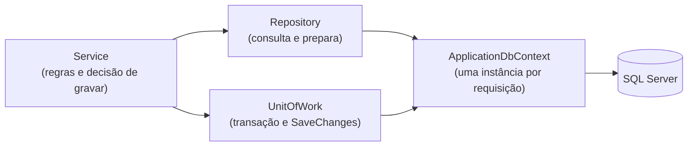
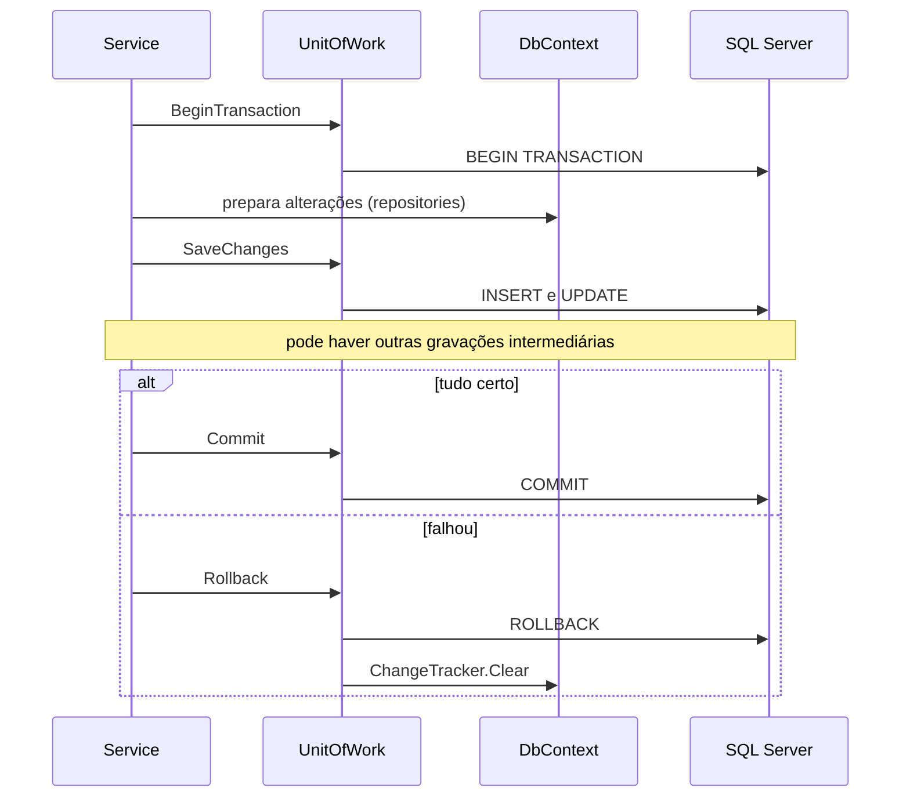

# Comunicação com o banco

Este documento responde: **como o código conversa com o SQL Server, quem decide quando gravar, como as transações funcionam e o que acontece em caso de conflito**. As tabelas estão descritas em [03-modelo-de-dados](03-modelo-de-dados.md); a política resumida está no [mapa de responsabilidades](entrega/MAPA-DE-RESPONSABILIDADES.md), seção 6.

## Sumário

1. [Os componentes](#1-os-componentes)
2. [Repositories: consultar e preparar](#2-repositories-consultar-e-preparar)
3. [Quem grava e quando](#3-quem-grava-e-quando)
4. [UnitOfWork e transações](#4-unitofwork-e-transações)
5. [Alterações de estoque](#5-alterações-de-estoque)
6. [Rastreamento de entidades (tracking)](#6-rastreamento-de-entidades-tracking)
7. [Concorrência](#7-concorrência)
8. [Imagens: o banco e o disco](#8-imagens-o-banco-e-o-disco)
9. [Consultas e desempenho](#9-consultas-e-desempenho)
10. [Como ver o SQL gerado](#10-como-ver-o-sql-gerado)
11. [Limitações](#11-limitações)

---

## 1. Os componentes

O ponto central: **repositories e `UnitOfWork` recebem o mesmo `ApplicationDbContext`**, porque todos são registrados com ciclo de vida `Scoped` (uma instância por requisição). Por isso, uma entidade que um repository carregou ou criou é a mesma que o `UnitOfWork` vai gravar.

| Componente | Papel | Onde fica |
|---|---|---|
| `ApplicationDbContext` | Mapeia as 14 tabelas e executa o SQL | `Data/` |
| Repository | Consulta e **prepara** alterações no contexto | `Modules/<Modulo>/Repositories` |
| `IUnitOfWork` / `UnitOfWork` | Abre a transação, grava, confirma ou desfaz | `Compartilhado/Repositories` |
| Service | Decide **quando** gravar e como reagir a falhas | `Modules/<Modulo>/Services` |

## 2. Repositories: consultar e preparar

Há um repository por entidade principal, dentro do módulo dono dela:

| Módulo | Repositories |
|---|---|
| Estoque | `ProdutoRepository`, `CategoriaRepository`, `MovimentacaoEstoqueRepository` |
| Compras | `CompraEstoqueRepository`, `FornecedorRepository` |
| Vendas | `VendaRepository` |
| Loja | `PedidoRepository`, `CarrinhoRepository`, `ClienteRepository` |
| Usuarios | `UsuarioRepository` |

O que um repository faz:

- **Consultar:** `ObterPorId`, `ObterPorIds`, `ObterAtivos`, buscas com filtro, contagens e somas.
- **Preparar alterações:** `Adicionar`, `Remover`, `DefinirCategoriasDoProduto`. Estes métodos só informam ao contexto "isto vai ser inserido ou removido"; **nada vai ao banco ainda**.
- **Carregar o que a tela precisa:** relacionamentos são carregados com `Include`/`ThenInclude` (carregamento antecipado). Não há carregamento preguiçoso (*lazy loading*), então nada é consultado "por baixo dos panos" depois.

O que um repository **não** faz: decidir regra de negócio (por exemplo, se há saldo suficiente) nem controlar transação.

## 3. Quem grava e quando

Quem decide o momento da gravação é o **Service**. Há três formas, de acordo com o tamanho da operação:

| Forma | Quando usar | Exemplos |
|---|---|---|
| **Transação explícita** (`BeginTransaction`, `SaveChanges` uma ou mais vezes, `Commit`) | Operação que escreve em várias entidades e precisa de gravações intermediárias | Finalizar venda, checkout, cadastrar produto com imagem |
| **Um único `SaveChanges` pelo `UnitOfWork`** | Operação com várias alterações que podem ir juntas no fim | Cancelar venda, cancelar pedido (cliente ou Admin), confirmar entrega de compra, separar e entregar pedido, ajustar estoque, editar produto |
| **`SalvarAlteracoes` do repository** | CRUD simples de uma entidade | Carrinho, categorias, fornecedores, usuários, cadastro de cliente, cadastrar e excluir compra, edição rápida de preço |

Um único `SaveChanges` já é **atômico**: o Entity Framework envolve todas as alterações pendentes numa só transação do banco. Por isso as operações do segundo grupo não precisam de transação explícita.

## 4. UnitOfWork e transações

Os quatro métodos de `IUnitOfWork`:

| Método | O que faz |
|---|---|
| `BeginTransaction` | Abre uma transação no banco |
| `SaveChanges` | Grava no banco tudo o que está pendente no contexto |
| `Commit` | Confirma a transação e a descarta |
| `Rollback` | Desfaz a transação, descarta-a **e limpa o estado rastreado** (`ChangeTracker.Clear`) |

**Por que o `Rollback` limpa o rastreamento.** Desfazer a transação no banco não desfaz o que está na memória. Sem a limpeza, um produto cujo saldo foi reduzido em memória continuaria "reduzido" no contexto, e uma nova tentativa na mesma requisição (como o retry do checkout) leria o valor errado. Com `Clear`, a próxima consulta busca o estado real no banco.

**Rollback sem transação aberta.** `Commit` e `Rollback` ignoram a chamada se não houver transação. Operações do segundo grupo da seção 3 (por exemplo, cancelar venda) chamam `Rollback` mesmo sem `BeginTransaction`: nesse caso o efeito é só limpar as alterações pendentes da memória, que nunca chegaram ao banco, e isso basta para "desfazer".

**Exemplo: a venda no balcão.** O serviço precisa gravar a venda antes de dar a saída de estoque, porque a movimentação aponta para o identificador do item de venda, que só existe depois do primeiro `SaveChanges`:

1. `BeginTransaction`.
2. Valida e monta a venda e seus itens.
3. `SaveChanges` (grava a venda e os itens; agora os itens têm identificador).
4. Para cada item, `RegistrarSaida` (reduz o saldo e prepara a movimentação).
5. `SaveChanges` e `Commit`.

Se qualquer passo falhar, `Rollback` desfaz tudo, inclusive a venda gravada no passo 3. O checkout segue o mesmo desenho com o pedido.

## 5. Alterações de estoque

As operações de `IMovimentacaoEstoqueService` (`RegistrarSaida`, `RegistrarDevolucao`, `RegistrarEntrada`) **não gravam**: elas alteram o saldo do produto no contexto e preparam a movimentação. Quem grava é o serviço que chamou, junto com o resto da operação. É isso que faz o saldo, a movimentação e a venda (ou compra, ou pedido) irem juntos ou não irem.

Um cuidado na devolução: `RegistrarDevolucao` consulta o banco (`ExisteMovimentacao`) para saber se aquele item já foi devolvido. Como a consulta vai ao banco, ela enxerga devoluções **já gravadas**, não as que ainda estão pendentes na mesma operação. Funciona porque cada item de uma operação tem origem diferente; o que impede a devolução repetida entre operações é a gravação da primeira.

## 6. Rastreamento de entidades (tracking)

Todas as consultas do projeto usam o comportamento padrão do Entity Framework: **as entidades carregadas ficam rastreadas** pelo contexto, e `SaveChanges` grava tudo o que mudou nelas. Nenhuma consulta usa `AsNoTracking`.

Consequências práticas:

- Carregar o mesmo produto duas vezes na mesma requisição devolve **a mesma instância**. Por isso, uma saída registrada em memória já aparece em leituras seguintes da mesma operação.
- Alterar uma propriedade de uma entidade carregada (por exemplo, `produto.ProdutoQtdEstoque -= quantidade`) basta para o `SaveChanges` gerar o `UPDATE`.
- Consultas só de leitura (como as do dashboard) também são rastreadas, o que custa memória (veja a seção 9).

## 7. Concorrência

`Produtos` tem a coluna `RowVersion` (marca de versão do SQL Server). Quando o Entity Framework grava um produto, ele só atualiza se a versão ainda for a que foi lida. Se outra operação alterou o mesmo produto no meio tempo, a gravação falha com `DbUpdateConcurrencyException`. Isso impede que duas vendas simultâneas "gastem" o mesmo saldo.

| Operação | Como trata o conflito |
|---|---|
| **Checkout** | Faz `Rollback` (que limpa o rastreamento) e **tenta de novo, até 3 vezes**; na nova tentativa o saldo é relido do banco. Esgotadas as tentativas, devolve uma mensagem pedindo para tentar novamente |
| **Expiração de pedidos** | Faz `Rollback` daquele pedido, não o conta como expirado e segue para o próximo; ele será reprocessado no próximo ciclo (15 minutos) |
| **Venda no balcão** | O conflito cai no tratamento geral de erro: `Rollback` e retorno de uma mensagem de erro, **sem nova tentativa** (a equipe pode refazer a venda) |
| **Demais operações** | Não tratam o conflito especificamente; a exceção sobe e, fora do ambiente de desenvolvimento, a página de erro é exibida |

O rollback, o descarte do estado após uma falha e o conflito na expiração de pedidos têm teste. O retry de conflito do checkout **não** tem teste de integração (veja o [mapa de responsabilidades](entrega/MAPA-DE-RESPONSABILIDADES.md), seção 10).

## 8. Imagens: o banco e o disco

A imagem do produto não fica no banco. O arquivo é gravado em `wwwroot/uploads/produtos` pelo `ArmazenamentoService`, e a coluna `ProdutoImagemUrl` guarda só o caminho relativo.

Como a transação do SQL Server não desfaz arquivos, o cadastro de produto faz uma compensação:

1. Abre a transação e grava o produto.
2. Salva a imagem no disco e guarda o caminho no produto.
3. Grava as categorias e confirma.
4. Se algo falhar: `Rollback` e **remoção do arquivo** que já tinha sido salvo, para não sobrar imagem sem produto.

Na edição de produto, a imagem nova é gravada **antes**, e a antiga só é apagada depois que o banco já aponta para a nova. Se a gravação falhar, a antiga continua valendo (sobra apenas o arquivo novo, sem uso).

O nome do arquivo é gerado pelo servidor (`<ProdutoID>_<identificador único>.<extensão>`): do nome enviado pelo navegador só se aproveita a extensão, e só são aceitas `.jpg`, `.jpeg`, `.png`, `.webp` e `.gif`.

## 9. Consultas e desempenho

- **Somas e contagens no banco.** O resumo financeiro do dashboard (quantidade, faturamento e lucro) e as contagens de alertas de estoque são calculados com `COUNT` e `SUM` no SQL, sem trazer as entidades para a memória.
- **Carregamento antecipado.** Telas com detalhes usam `Include`/`ThenInclude` para trazer itens, produtos e usuários numa consulta só, evitando dezenas de consultas pequenas.
- **Catálogo.** A busca de produtos da loja filtra por nome e categoria no banco, mas calcula o estoque disponível online e monta as categorias em memória, depois de uma segunda consulta. O detalhe de **um** produto (`ObterCatalogoPorId`) reaproveita essa busca: carrega o catálogo ativo inteiro e só então escolhe o produto em memória (veja a seção 11).
- **Gráficos e previsão do dashboard.** Ainda carregam listas de vendas e pedidos com itens e produtos para agrupar em memória (limitação conhecida, veja a seção 11).

## 10. Como ver o SQL gerado

O nível de log padrão (`Default: Information`, em `appsettings.json`) já faz o Entity Framework escrever cada comando SQL no console da aplicação. Para observar uma operação:

1. Rode o projeto e faça a ação na tela (por exemplo, finalizar uma venda).
2. No console, procure as linhas `Executed DbCommand`.
3. Repare nos `INSERT` da venda e dos itens, seguidos do `UPDATE` do produto, que confere o `RowVersion` na cláusula `WHERE`. A abertura e a confirmação da transação são registradas em um nível de log mais detalhado (`Debug`), então não aparecem com a configuração padrão.

Para ver também os eventos de transação, acrescente `"Microsoft.EntityFrameworkCore": "Debug"` em `Logging:LogLevel` no `appsettings.Development.json` (o volume de log aumenta bastante; remova depois).

## 11. Limitações

- **Nenhuma consulta usa `AsNoTracking`.** Consultas somente de leitura, como as do dashboard, mantêm as entidades rastreadas sem necessidade.
- **Dashboard carrega histórico em memória** para gráficos e previsão.
- **Detalhe de produto da loja carrega o catálogo inteiro.** `ObterCatalogoPorId` chama `ObterCatalogo(null, null)` e filtra depois; com um catálogo grande, isso é desperdício a cada consulta de detalhe.
- **Serviços síncronos.** O acesso ao banco bloqueia a thread da requisição.
- **Conflito de concorrência tratado só no checkout e na expiração.** Nas demais operações o usuário recebe a página de erro.
- **Imagem sem limite de tamanho.** Vale apenas o limite padrão do servidor para o tamanho da requisição.
- **Política de gravação por convenção.** Nada impede que um serviço novo chame `SalvarAlteracoes` num fluxo com várias entidades; a regra está no mapa de responsabilidades e na revisão do código, não em teste.
