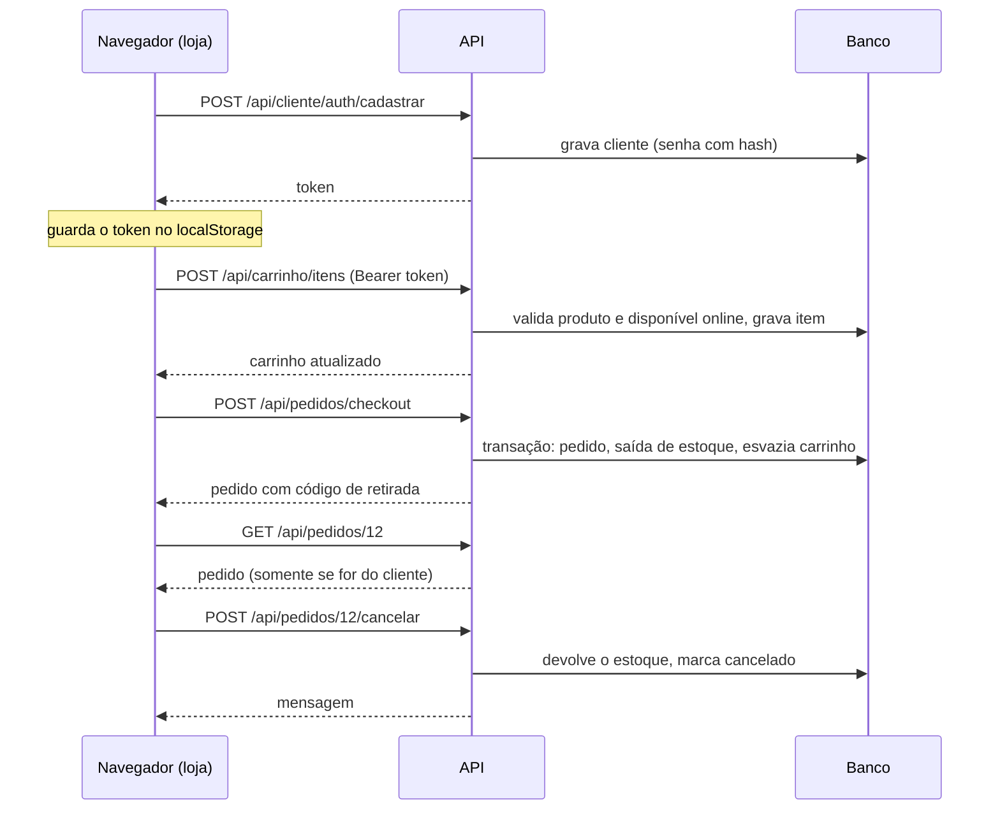

# API e rotas

Este documento responde: **quais portas HTTP o PolarDrinks expõe, o que cada uma recebe e devolve, e quem pode usá-las**. O funcionamento interno de cada operação está em [08-fluxos-principais](08-fluxos-principais.md); a autenticação em detalhe, em [06-autenticacao-e-permissoes](06-autenticacao-e-permissoes.md).

## Sumário

1. [Duas superfícies HTTP](#1-duas-superfícies-http)
2. [Convenções da API](#2-convenções-da-api)
3. [Resumo dos endpoints](#3-resumo-dos-endpoints)
4. [Catálogo](#4-catálogo)
5. [Conta do cliente](#5-conta-do-cliente)
6. [Carrinho](#6-carrinho)
7. [Pedidos](#7-pedidos)
8. [Jornada completa do cliente](#8-jornada-completa-do-cliente)
9. [Telas da equipe (MVC)](#9-telas-da-equipe-mvc)
10. [Como experimentar](#10-como-experimentar)
11. [Limitações](#11-limitações)

---

## 1. Duas superfícies HTTP

O mesmo projeto atende dois tipos de cliente, com estilos diferentes:

| Superfície | Quem usa | Estilo | Autenticação |
|---|---|---|---|
| **API REST** (`/api/...`) | Loja online (JavaScript no navegador do cliente) | JSON; controllers com `[ApiController]` em `Modules/Loja/Controllers/Api` | JWT no cabeçalho `Authorization` |
| **Telas MVC** (`/Controller/Action`) | Equipe (Admin e Funcionário) | HTML renderizado no servidor (Razor), formulários | Sessão + filtros `AuthFilter` e `AdminFilter` |

A API REST existe **somente para a loja online** (RF27 a RF33). A administração não tem API: ela usa as telas da seção 9. Há ainda as páginas HTML da loja (`/Loja/Catalogo`, `/Loja/Carrinho` etc.), que não trazem dados: elas carregam o JavaScript, e é o JavaScript que chama a API.

## 2. Convenções da API

| Item | Como é |
|---|---|
| Endereço base | Local: `http://localhost:5153`; Docker: `http://localhost:8080` (veja o [README](../README.md)) |
| Formato | JSON, com nomes de campo em **camelCase** (`pedidoID`, `produtoNome`). Envie `Content-Type: application/json` |
| Autenticação | Endpoints protegidos exigem `Authorization: Bearer <token>`. O token vem do cadastro ou do login e vale 24 horas |
| Erro de regra de negócio | `400 Bad Request` com `{ "mensagem": "..." }` |
| Credencial inválida | `401 Unauthorized` com `{ "mensagem": "..." }` no login; sem corpo quando falta o token ou ele é inválido ou expirou |
| Recurso inexistente | `404 Not Found` sem corpo |
| Sucesso | `200 OK` (a API não usa `201` nem `204`) |
| Corpo malformado | `400` automático do ASP.NET (o atributo `[ApiController]` valida o formato do corpo) |
| Versionamento e documentação | Não há versão na rota, nem OpenAPI/Swagger. Esta página e o arquivo `PolarDrinks.http` são a documentação |

O servidor decide preço, total, data e identificação do cliente. O corpo das requisições leva só o que o cliente pode informar (RNF04); o identificador do cliente vem sempre do token, nunca do corpo ou da rota.

## 3. Resumo dos endpoints

Quinze endpoints, em quatro grupos. Todos ficam em `Modules/Loja/Controllers/Api`.

| Método | Rota | Acesso | Req. | O que faz |
|---|---|---|---|---|
| GET | `/api/catalogo/produtos` | Público | RF27 | Lista/busca produtos ativos (`termo`, `categoriaId`) |
| GET | `/api/catalogo/produtos/{id}` | Público | RF27 | Detalhe de um produto |
| GET | `/api/catalogo/categorias` | Público | RF27 | Lista categorias ativas |
| POST | `/api/cliente/auth/cadastrar` | Público | RF28 | Cria conta e já devolve o token |
| POST | `/api/cliente/auth/login` | Público | RF28 | Entra e devolve o token |
| GET | `/api/carrinho` | Cliente | RF29 | Ver o carrinho |
| POST | `/api/carrinho/itens` | Cliente | RF29, RF30 | Adicionar item |
| PUT | `/api/carrinho/itens/{produtoId}` | Cliente | RF29, RF30 | Alterar a quantidade |
| DELETE | `/api/carrinho/itens/{produtoId}` | Cliente | RF29 | Remover item |
| DELETE | `/api/carrinho` | Cliente | RF29 | Esvaziar o carrinho |
| POST | `/api/carrinho/mesclar` | Cliente | RF29 | Juntar o carrinho do navegador ao da conta |
| POST | `/api/pedidos/checkout` | Cliente | RF31 | Finalizar o pedido |
| GET | `/api/pedidos` | Cliente | RF32 | Listar os pedidos do cliente |
| GET | `/api/pedidos/{id}` | Cliente | RF32 | Detalhe de um pedido do cliente |
| POST | `/api/pedidos/{id}/cancelar` | Cliente | RF33 | Cancelar o próprio pedido |

Os controllers `CarrinhoController` e `PedidoController` têm `[Authorize]`: toda a rota exige token válido.

## 4. Catálogo

### `GET /api/catalogo/produtos`

Parâmetros opcionais na query: `termo` (parte do nome) e `categoriaId`. Sem parâmetros, lista todos os produtos ativos.

```json
[
  {
    "produtoID": 1,
    "produtoNome": "Cerveja Pilsen 350ml",
    "produtoDescricao": "Lata gelada",
    "produtoPrecoVenda": 6.50,
    "produtoPromocao": 10,
    "produtoImagemUrl": "uploads/produtos/pilsen.png",
    "produtoQtdEstoque": 48,
    "estoqueDisponivelOnline": 38,
    "categorias": ["Cervejas"]
  }
]
```

- `produtoPrecoVenda` é o preço **base**; `produtoPromocao` é o **percentual** de desconto. O preço final calculado pelo servidor aparece no carrinho (`precoUnitario`) e no pedido.
- `estoqueDisponivelOnline` é o saldo menos o estoque mínimo (nunca negativo): é o limite que o cliente consegue comprar.

### `GET /api/catalogo/produtos/{id}`

Devolve um produto no mesmo formato acima, ou `404` se não existir ou estiver inativo.

### `GET /api/catalogo/categorias`

```json
[ { "categoriaID": 1, "categoriaNome": "Cervejas", "categoriaAtiva": true } ]
```

## 5. Conta do cliente

### `POST /api/cliente/auth/cadastrar`

```json
{
  "nome": "Cliente de Teste",
  "email": "cliente.teste@exemplo.com",
  "senha": "senha123",
  "confirmacaoSenha": "senha123",
  "telefone": "11999990000",
  "cpf": "12345678900"
}
```

`telefone` é opcional. Sucesso (`200`): `{ "token": "<jwt>", "mensagem": "Conta criada com sucesso!" }`.

Erros (`400`) trazem também o campo problemático em `campo`:

| Situação | `mensagem` | `campo` |
|---|---|---|
| Nome vazio | Informe seu nome. | `nome` |
| E-mail vazio | Informe seu e-mail. | `email` |
| Senha curta (menos de 6) | A senha deve ter pelo menos 6 caracteres. | `senha` |
| Confirmação diferente | As senhas não conferem. | `confirmacaoSenha` |
| CPF vazio | Informe seu CPF. | `cpf` |
| E-mail já cadastrado | Já existe uma conta com esse e-mail. | `email` |
| CPF já cadastrado | Já existe uma conta com esse CPF. | `cpf` |

O e-mail é guardado em minúsculas e sem espaços nas pontas; a senha, com hash BCrypt.

### `POST /api/cliente/auth/login`

```json
{ "email": "cliente.teste@exemplo.com", "senha": "senha123" }
```

Sucesso (`200`): `{ "token": "<jwt>", "mensagem": "Login realizado com sucesso!" }`.
Falha (`401`): `E-mail ou senha incorretos.` ou, quando a senha está certa mas a conta foi desativada, `Esta conta está inativa.`

O token carrega o identificador, o e-mail e o nome do cliente. Nas chamadas seguintes, o identificador é lido do token.

## 6. Carrinho

Todas as rotas exigem token. Com exceção de `DELETE /api/carrinho`, todas respondem com o **carrinho atualizado**:

```json
{
  "itens": [
    {
      "produtoID": 1,
      "produtoNome": "Cerveja Pilsen 350ml",
      "produtoImagemUrl": "uploads/produtos/pilsen.png",
      "precoUnitario": 5.85,
      "quantidade": 2,
      "subtotal": 11.70
    }
  ],
  "total": 11.70,
  "avisosRemocao": []
}
```

`avisosRemocao` lista os produtos que foram **removidos automaticamente** porque ficaram inativos desde que o cliente os adicionou.

| Rota | Corpo | Observações |
|---|---|---|
| `GET /api/carrinho` | – | Remove do carrinho os produtos inativos, avisando em `avisosRemocao` |
| `POST /api/carrinho/itens` | `{ "produtoID": 1, "quantidade": 2 }` | A quantidade é **somada** à que já existe do produto; `quantidade` omitida vale 1 |
| `PUT /api/carrinho/itens/{produtoId}` | `{ "quantidade": 3 }` | Define a quantidade; zero ou negativa remove o item |
| `DELETE /api/carrinho/itens/{produtoId}` | – | Remove o item; se ele não existir, responde `200` mesmo assim |
| `DELETE /api/carrinho` | – | Responde `{ "mensagem": "Carrinho esvaziado." }` |
| `POST /api/carrinho/mesclar` | `[ { "produtoID": 1, "quantidade": 1 } ]` | Adiciona cada item como em `POST .../itens`; erros de itens individuais são ignorados |

Erros de regra (`400`, `{ "mensagem": ... }`):

| Situação | Mensagem |
|---|---|
| Produto inexistente ou inativo | Produto não encontrado ou indisponível. |
| Quantidade acima do disponível online | Apenas N unidade(s) de X disponíveis. |
| Nada disponível online (só estoque mínimo) | X apenas na loja física. |
| Atualizar item que não está no carrinho | Item não encontrado no carrinho. |

## 7. Pedidos

Todas as rotas exigem token e só enxergam pedidos **do cliente do token**.

### `POST /api/pedidos/checkout`

```json
{ "tipoPagamento": "Pix" }
```

Valores aceitos: `"Pix"` ou `"Cartao"` (exatamente assim, com essa grafia). O pedido é montado a partir do carrinho do cliente; o carrinho é esvaziado e o estoque é baixado, tudo numa transação (veja [04](04-comunicacao-com-o-banco.md)).

Sucesso (`200`), no formato de pedido:

```json
{
  "pedidoID": 12,
  "pedidoCodigo": "4821",
  "pedidoData": "2026-10-19T21:30:00",
  "pedidoStatus": "AguardandoSeparacao",
  "pedidoValorTotal": 11.70,
  "pedidoTipoPagamento": "Pix",
  "pedidoDataSeparado": null,
  "pedidoDataConcluido": null,
  "itens": [
    { "itemPedidoQtd": 2, "itemPedidoPreco": 5.85, "produto": { "produtoNome": "Cerveja Pilsen 350ml" } }
  ]
}
```

`pedidoCodigo` é o código de retirada, com 4 dígitos. O contrato de resposta (`PedidoResponse`) **não expõe** custo, dados do cliente nem os funcionários que atenderam o pedido.

Erros (`400`):

| Situação | Mensagem |
|---|---|
| Forma de pagamento diferente de Pix e Cartao | Forma de pagamento inválida. |
| Carrinho vazio | Seu carrinho está vazio. |
| Produto inativo ou removido | Um produto do seu carrinho não está mais disponível. |
| Saldo menor que o pedido | Estoque insuficiente para: X |
| Acima do disponível online | Apenas N unidade(s) de X disponíveis. / X apenas na loja física. |
| Conflito de concorrência após 3 tentativas | Não foi possível processar seu pedido no momento devido a alta demanda. Tente novamente. |
| Falha inesperada | Erro ao processar pedido: (texto técnico da exceção) |

### `GET /api/pedidos` e `GET /api/pedidos/{id}`

A listagem devolve uma lista de pedidos no formato acima; o detalhe, um pedido. Pedido que não existe **ou pertence a outro cliente** responde `404`: a API não revela que o pedido existe.

Valores de `pedidoStatus`:

| Valor | Significado |
|---|---|
| `AguardandoSeparacao` | Recém-criado |
| `Separado` | Pronto para retirada |
| `Concluido` | Entregue ao cliente |
| `CanceladoCliente` | Cancelado pelo cliente |
| `CanceladoNaoRetirado` | Cancelado automaticamente por não retirada |
| `CanceladoAdmin` | Cancelado pelo Admin após a entrega |

### `POST /api/pedidos/{id}/cancelar`

Sem corpo. Sucesso (`200`): `{ "mensagem": "Pedido cancelado com sucesso. O estorno será processado." }`. Como o sistema não processa pagamentos, a frase sobre o estorno é apenas informativa.

| Situação (`400`) | Mensagem |
|---|---|
| Pedido não é do cliente, ou não existe | Pedido não encontrado. |
| Status fora de AguardandoSeparacao e Separado | Este pedido não pode mais ser cancelado. |
| Passaram 24 horas | O prazo de 24 horas para cancelamento já passou. |

## 8. Jornada completa do cliente



No navegador, o JavaScript guarda o token em `localStorage` (chave `polardrinks_token`) e, antes do login, mantém o carrinho local em `carrinho_local`; ao entrar, chama `/api/carrinho/mesclar` para juntar os dois. Os scripts ficam em `wwwroot/js/loja/`.

## 9. Telas da equipe (MVC)

As telas seguem a rota convencional `/{controller}/{action}/{id?}` e a página inicial é `Auth/Login`. Os dados são enviados por formulário (não JSON). A coluna **Acesso** vem dos filtros do controller ou da action: `Equipe` exige apenas estar logado (`AuthFilter`); `Admin` exige também o perfil Admin (`AdminFilter`). Quem não está logado vai para o login; quem não é Admin vai para a tela de acesso negado.

| Módulo | Controller | Ações | Acesso |
|---|---|---|---|
| Usuários | `Auth` | `Login` (GET e POST), `Logout`, `Deslogar`, `AcessoNegado` | Público |
| Usuários | `Usuario` | `Index`, `Cadastrar`, `AlterarSenha`, `Desativar` | Admin |
| Estoque | `Estoque` | `Index` | Equipe |
| Estoque | `Estoque` | `Cadastrar`, `Editar`, `EdicaoRapida`, `AjustarEstoque`, `Movimentacoes` | Admin |
| Estoque | `Categoria` | `Index`, `Cadastrar`, `Editar` | Admin |
| Compras | `Fornecedor` | `Index` | Equipe |
| Compras | `Fornecedor` | `Cadastrar`, `Editar` | Admin |
| Compras | `CompraEstoque` | `Index`, `Cadastrar`, `Detalhes`, `ConfirmarEntrega`, `Excluir`, `ConfirmarExclusao` | Admin |
| Vendas | `Venda` | `Cadastrar`, `FinalizarVenda` | Equipe |
| Vendas | `Venda` | `Index`, `Detalhes`, `Cancelar`, `CancelarVenda` | Admin |
| Loja (atendimento) | `PedidoOnline` | `Index`, `Detalhes`, `MarcarComoSeparado`, `VoltarParaSeparacao`, `ConfirmarEntrega`, `Historico` | Equipe |
| Loja (atendimento) | `PedidoOnline` | `CancelarAposEntrega` | Admin |
| Dashboard | `Dashboard` | `Index` | Admin |
| Compartilhado | `Home` | `Index`, `Error` | Equipe |
| Loja (páginas) | `Loja` | `Catalogo`, `Conta`, `Carrinho`, `PedidoConfirmado`, `Perfil` | Público (a página; os dados vêm da API) |

Duas observações de leitura:

- **Ações com dois métodos.** `Cadastrar`, `Editar`, `AlterarSenha`, `Desativar` e `Cancelar` têm uma versão GET (mostra o formulário ou a confirmação) e uma POST (executa). As demais ações que alteram dados são POST.
- **Venda no balcão.** `Venda/FinalizarVenda` recebe um objeto com `vendaTipoPagamento` e a lista de `itens` (`produtoID` e `itemVendaQtd`). O contrato não aceita preço, custo, total, data nem usuário: o servidor os define.

## 10. Como experimentar

O arquivo **`PolarDrinks.http`**, na pasta `docs/`, reúne uma requisição pronta para cada endpoint da seção 3, mais os casos de erro. No Visual Studio 2022 (17.8 ou superior), abra o arquivo e clique em "Enviar solicitação" acima de cada requisição, de cima para baixo: o pedido `login` guarda o token e os seguintes o usam.

Sem o Visual Studio, o mesmo roteiro funciona com `curl`:

```bash
# 1. Entrar e guardar o token
TOKEN=$(curl -s -X POST http://localhost:5153/api/cliente/auth/login \
  -H "Content-Type: application/json" \
  -d '{"email":"cliente.teste@exemplo.com","senha":"senha123"}' | sed 's/.*"token":"\([^"]*\)".*/\1/')

# 2. Ver o carrinho
curl -s http://localhost:5153/api/carrinho -H "Authorization: Bearer $TOKEN"
```

O cadastro precisa de e-mail e CPF novos a cada vez, porque ambos são únicos. O roteiro completo de verificação (incluindo as telas) está em [10-guia-de-testes](10-guia-de-testes.md).

## 11. Limitações

- **Sem OpenAPI/Swagger e sem versionamento.** A documentação é manual (esta página e o `.http`) e pode ficar desatualizada se a API mudar.
- **Sem tratamento global de erros na API.** Uma exceção não prevista não vira o formato `{ "mensagem": ... }`: fora do ambiente de desenvolvimento, o ASP.NET reexecuta a requisição em `/Home/Error`, que é uma tela da equipe (exige sessão), então um cliente da loja pode não receber uma resposta de erro útil. Em dois pontos (checkout e finalização de venda) a mensagem devolvida inclui o texto técnico da exceção.
- **O carrinho não valida quantidade menor ou igual a zero ao adicionar.** `POST /api/carrinho/itens` e a mesclagem só conferem o limite superior; o teste de quantidade zero ou negativa existe apenas na atualização (`PUT`). Um item com quantidade inválida entra no carrinho e o checkout é recusado pela camada de estoque, com rollback e a mensagem "A quantidade deve ser maior que zero."; o cliente precisa remover o item. O estoque não é corrompido, mas o carrinho fica bloqueado até a remoção.
- **`GET /api/carrinho` altera dados.** Ao listar, remove do banco os itens de produtos inativos. É prático para o cliente, mas foge da expectativa de que um `GET` apenas leia.
- **O catálogo público mostra o saldo real** (`produtoQtdEstoque`), além do disponível online.
- **Confirmar entrega de compra é um `GET`.** Na tela de detalhes da compra, "Confirmar entrega" é um link (`CompraEstoque/ConfirmarEntrega/{id}`), e uma requisição `GET` altera o estoque. Um link externo aberto por um Admin logado poderia disparar a confirmação. O cookie de sessão usa o padrão `SameSite=Lax` do navegador, que ainda envia o cookie em navegação por link.
- **Sem validação de antifalsificação (CSRF) nos formulários.** Nenhum `[ValidateAntiForgeryToken]` é aplicado. Para os `POST`, o `SameSite=Lax` do cookie já bloqueia o envio a partir de outros sites na maioria dos navegadores, mas a proteção depende do navegador, não do servidor.
- **Sem limite de tentativas no login** nem recuperação de senha.
- **Sem paginação.** Catálogo e listas de pedidos devolvem todos os registros.
