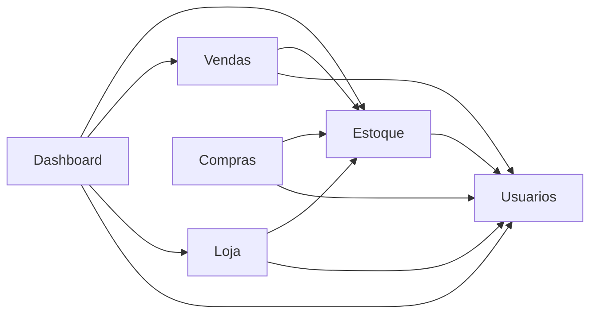

# Mapa de responsabilidades

Este documento diz **quem é dono de cada regra** no PolarDrinks, **quem pode depender de quem** e **o que acontece quando algo falha no meio de uma operação**. Tudo aqui foi conferido contra o código da branch `refactor/modulos`.

## Sumário

1. [Por que um monólito em camadas organizado em módulos](#1-por-que-um-monólito-em-camadas-organizado-em-módulos)
2. [Módulos e o que cada um possui](#2-módulos-e-o-que-cada-um-possui)
3. [Dependências permitidas entre módulos](#3-dependências-permitidas-entre-módulos)
4. [Quem controla preço e estoque](#4-quem-controla-preço-e-estoque)
5. [Contratos HTTP: o que o cliente pode enviar](#5-contratos-http-o-que-o-cliente-pode-enviar)
6. [Política de gravação e transações](#6-política-de-gravação-e-transações)
7. [O que acontece quando uma operação falha no meio](#7-o-que-acontece-quando-uma-operação-falha-no-meio)
8. [Autenticação e autorização](#8-autenticação-e-autorização)
9. [Regras de negócio que merecem explicação](#9-regras-de-negócio-que-merecem-explicação)
10. [Exceções e limitações conhecidas](#10-exceções-e-limitações-conhecidas)

---

## 1. Por que um monólito em camadas organizado em módulos

- **Monólito:** há um único projeto web (`PolarDrinks`) e um único banco SQL Server. Administração, loja online, APIs e o job de expiração são pontos de entrada da mesma aplicação. Para o tamanho da equipe e do sistema, isso evita custo de comunicação entre serviços, de implantação separada e de consistência distribuída. Uma venda e a baixa de estoque, por exemplo, cabem em uma única transação de banco.
- **Camadas:** dentro de cada módulo, o fluxo é sempre `Controller → Service → Repository → Banco`. O Controller recebe e responde HTTP, o Service decide as regras, o Repository fala com o Entity Framework.
- **Módulos:** as pastas em `Modules/` agrupam **capacidades de negócio** (Estoque, Compras, Vendas...). Cada módulo tem suas próprias camadas dentro de si (`Controllers`, `Services`, `Repositories`, `Models`, `Views`).
- **MVC e camadas coexistem:** MVC organiza a interação com a tela (Controller e View, com Razor). As camadas organizam a responsabilidade técnica. Um módulo contém as duas coisas.
- **O que faz uma pasta ser um módulo:** ter um dono claro das suas tabelas e regras, expor contratos públicos (interfaces de serviço) e depender apenas de módulos autorizados na seção 3. Essa última condição é **verificada por testes automatizados**, não só combinada.

## 2. Módulos e o que cada um possui

| Módulo | Controllers | Services principais | Entidades que possui |
|---|---|---|---|
| `Usuarios` | `AuthController`, `UsuarioController` | `UsuarioService` | `UsuarioModel` |
| `Estoque` | `EstoqueController`, `CategoriaController` | `EstoqueService`, `MovimentacaoEstoqueService`, `CategoriaService`, `ArmazenamentoService` | `ProdutoModel`, `CategoriaModel`, `ProdutoCategoriaModel`, `MovimentacaoEstoqueModel` |
| `Compras` | `CompraEstoqueController`, `FornecedorController` | `CompraEstoqueService`, `FornecedorService` | `CompraEstoqueModel`, `ItemCompraModel`, `FornecedorModel` |
| `Vendas` | `VendaController` | `VendaService` | `VendaModel`, `ItemVendaModel` |
| `Loja` | `LojaController`, `PedidoOnlineController` e as APIs em `Controllers/Api` | `PedidoService`, `CarrinhoService`, `CatalogoService`, `ClienteAuthService`, `TokenService` | `PedidoModel`, `ItemPedidoModel`, `CarrinhoItemModel`, `ClienteModel` |
| `Dashboard` | `DashboardController` | `DashboardService`, `RelatorioService`, `PrevisaoLinear` | nenhuma (só lê dos outros módulos) |

Observações:

- **Categorias** pertencem ao Estoque e **Fornecedores** pertencem a Compras.
- O que é de todos fica em `Compartilhado`: `ResultadoOperacao`, `IUnitOfWork`/`UnitOfWork`, `AuthFilter`, `AdminFilter`, `ModuloViewLocationExpander`, `HomeController` e `ErrorViewModel`.
- `Data/` (contexto do banco) e `Migrations/` ficam na raiz do projeto porque o banco é um só.

## 3. Dependências permitidas entre módulos

Um módulo sempre pode usar o próprio código e o `Compartilhado`. Para usar outro módulo, a seta precisa existir abaixo.

| Módulo | Pode depender de |
|---|---|
| `Usuarios` | nenhum |
| `Estoque` | `Usuarios` |
| `Compras` | `Estoque`, `Usuarios` |
| `Vendas` | `Estoque`, `Usuarios` |
| `Loja` | `Estoque`, `Usuarios` |
| `Dashboard` | `Estoque`, `Vendas`, `Loja`, `Usuarios` |

Ou seja: `Compras`, `Vendas` e `Loja` **não conhecem uns aos outros**, e o `Dashboard` apenas **lê**.

**Acesso de leitura do relatório de vendas.** O relatório de vendas do Dashboard lê as tabelas de Vendas e de Loja por meio das procedures de resumo (`sp_ResumoVendasPorPeriodo`, `sp_ResumoPedidosOnlinePorPeriodo` e `sp_ResumoGeralPorPeriodo`), chamadas pelo `RelatorioRepository`. É um acesso somente de leitura, documentado aqui de propósito; nenhuma regra de atualização fica no Dashboard.

**Como isso é verificado:** os testes em `PolarDrinks.Tests/Arquitetura` (categoria `Arquitetura`) leem o código-fonte e falham se uma regra for quebrada. As regras estão em `RegrasDeArquitetura.cs`:

| Regra | O que garante |
|---|---|
| R1 | Módulos só dependem uns dos outros nas direções da tabela acima |
| R2 | Só o Estoque usa o repository de movimentações |
| R3 | Só o Estoque altera o saldo dos produtos |
| R4 | Controllers não acessam repositories nem o banco |
| R5 | Services e Repositories não usam tipos da camada web |
| R6 | Models não dependem das camadas de cima |
| R7 | `Compartilhado` não depende de módulos |
| R8 | O namespace de cada arquivo é igual ao caminho da pasta |
| R9 | As Views ficam no mesmo módulo do Controller |

**Exceção documentada (rastreabilidade):** `MovimentacaoEstoqueModel` referencia Compras, Vendas e Loja, porque cada movimentação guarda de qual item de venda, compra ou pedido ela veio. Só esse arquivo pode apontar do Estoque para esses módulos (`ArquivoDeRastreabilidade` nas regras).

## 4. Quem controla preço e estoque

### Preço

- **Dono:** `ProdutoModel.CalcularPrecoFinal()`, no módulo Estoque. É a única fórmula de preço.
- **Regra:** preço base nunca negativo (preço vazio vale 0); promoção só é aplicada se estiver entre 0 (exclusive) e 100 (inclusive), caso contrário é ignorada; resultado arredondado para 2 casas com `MidpointRounding.AwayFromZero`. Exemplo: R$ 100,00 com 15% de desconto resulta em R$ 85,00.
- **Quem usa:** `VendaService` (venda no balcão), `CarrinhoService` (carrinho) e `PedidoService` (checkout). Nenhum recalcula por conta própria.
- **No navegador:** o JavaScript só **estima** o valor para exibir. O servidor sempre recalcula, e o valor enviado pelo cliente não é usado.

### Estoque

- **Dono:** `IMovimentacaoEstoqueService`, no módulo Estoque. Os demais módulos **pedem** a alteração do saldo por ele, em vez de mexer na quantidade.

| Operação | O que faz | Quem chama |
|---|---|---|
| `RegistrarSaida` | valida quantidade e saldo, reduz a quantidade e registra a movimentação | `VendaService` (tipo `Saida`), `PedidoService` (tipo `SaidaOnline`) |
| `RegistrarDevolucao` | valida o tipo e a origem, recusa devolver duas vezes o mesmo item (`ExisteMovimentacao`) e devolve o saldo | `VendaService` (`Cancelamento`), `PedidoService` (`CancelamentoOnline`, em cancelamento, cancelamento após entrega e expiração) |
| `RegistrarEntrada` | aumenta o saldo na confirmação de uma compra | `CompraEstoqueService` |

- **Ajuste manual:** `EstoqueService.AjustarEstoque` fica dentro do próprio Estoque. Exige descrição de até 50 caracteres e registra uma movimentação do tipo `Edicao`.
- **Tipos de movimentação** (`MovimentacaoEstoqueModel.Tipos`): `Entrada`, `Saida`, `SaidaOnline`, `Edicao`, `Cancelamento`, `CancelamentoOnline`.
- **Garantia contra devolução repetida:** uma segunda tentativa de cancelar o mesmo item retorna erro e não gera nova entrada.

### Indicadores de estoque

- `IEstoqueService.ContarAlertasDeEstoque()` devolve a contagem de produtos **sem estoque** e **abaixo do mínimo**. Considera apenas produtos **ativos**, e os dois grupos **se sobrepõem** (produto zerado também está abaixo do mínimo). O Dashboard usa esse resultado sem repetir a regra.

## 5. Contratos HTTP: o que o cliente pode enviar

| Contrato | Onde fica | Campos que o cliente pode enviar |
|---|---|---|
| `FinalizarVendaRequest` | `Modules/Vendas/Models` | `VendaTipoPagamento` e a lista `Itens` |
| `ItemVendaRequest` | `Modules/Vendas/Models` | `ProdutoID` e `ItemVendaQtd` |
| `CheckoutRequest` | dentro de `PedidoController` | `TipoPagamento` |
| `AdicionarItemRequest` | dentro de `CarrinhoController` | `ProdutoID`, `Quantidade` |
| `AtualizarQuantidadeRequest` | dentro de `CarrinhoController` | `Quantidade` |
| `CadastroRequest` / `LoginRequest` | dentro de `ClienteAuthController` | dados de cadastro e de login do cliente |

**O que o servidor define sozinho** na venda: data, usuário, preço, custo, total e status. Qualquer campo extra enviado no JSON é ignorado, porque o contrato não o possui.

**Respostas de pedido:** `PedidoResponse`, `ItemPedidoResponse` e `ProdutoPedidoResponse` (`Modules/Loja/Models`). Retornam identificação, código de retirada, data, status, total, forma de pagamento, datas de separação e conclusão, e para cada item a quantidade, o preço e **apenas o nome** do produto. Não retornam custo, `RowVersion`, dados do cliente nem os funcionários que atenderam. O **código de retirada faz parte do contrato de propósito**: o cliente precisa dele para retirar o pedido, e os endpoints só devolvem pedidos do próprio cliente autenticado.

**Edição de produto:** a tela usa `ProdutoModel`, mas o `EstoqueService.EditarProduto` copia **explicitamente** apenas nome, descrição, código de barras, preço de venda, ativo, estoque mínimo, preço de custo, imagem e categorias. O **saldo não é alterado** por aqui (só por `AjustarEstoque`) e a promoção só muda pela `EdicaoRapida`.

### Rotas da API (Loja)

| Rota base | Acesso | Endpoints |
|---|---|---|
| `api/catalogo` | público | `GET produtos`, `GET produtos/{id}`, `GET categorias` |
| `api/cliente/auth` | público | `POST cadastrar`, `POST login` |
| `api/carrinho` | `[Authorize]` (JWT) | `GET`, `POST itens`, `PUT itens/{produtoId}`, `DELETE itens/{produtoId}`, `DELETE`, `POST mesclar` |
| `api/pedidos` | `[Authorize]` (JWT) | `POST checkout`, `GET`, `GET {id}`, `POST {id}/cancelar` |

## 6. Política de gravação e transações

- `IUnitOfWork` oferece `BeginTransaction`, `SaveChanges`, `Commit` e `Rollback`. O `Rollback` também descarta as alterações pendentes do contexto, para nada ficar "pela metade".
- **Operação que escreve em várias entidades** (venda, checkout, cadastro de produto): abre transação explícita e só confirma no fim.
- **Operação que termina em uma única gravação** (cancelar venda, cancelar pedido, confirmar entrega de compra, confirmar entrega de pedido): acumula as alterações e chama `SaveChanges` uma vez no final. Uma única gravação é atômica no Entity Framework.
- **CRUD simples de uma entidade** pode usar `SalvarAlteracoes` do repository.
- Services recebem `ResultadoOperacao` / `ResultadoOperacao<T>` (sucesso, mensagem e valor) em vez de lançar exceção para erros esperados.

## 7. O que acontece quando uma operação falha no meio

| Operação | Como é protegida | Se falhar |
|---|---|---|
| **Venda no balcão** (`FinalizarVenda`) | Validações **antes** de gravar (carrinho vazio, tipo de pagamento válido: Dinheiro, Pix ou Cartão, quantidade maior que zero). Depois, transação: agrupa linhas repetidas por produto, confere existência, `ProdutoAtivo` e saldo, calcula o preço e dá a saída. | Qualquer erro dá `Rollback`: não sobra venda, nem baixa de estoque, nem movimentação. Testado com banco real. |
| **Checkout online** (`Checkout`) | Transação com a criação do pedido, a saída de cada item e a limpeza do carrinho. | Erro dá `Rollback`. Em conflito de concorrência (`DbUpdateConcurrencyException`) tenta de novo, até 3 vezes. Esgotadas as tentativas, devolve mensagem pedindo para tentar novamente. |
| **Cadastro de produto com imagem** | Transação; a imagem é salva dentro dela. | Erro dá `Rollback` e a imagem recém-gravada é removida (`RemoverImagemProduto`). Testado com banco real. |
| **Confirmar entrega de compra** | Dá `RegistrarEntrada` de cada item e grava uma única vez. | Se um item falhar, `Rollback`: a compra continua pendente e nenhum saldo muda. Confirmar de novo uma compra já concluída não repete as entradas. |
| **Cancelar venda** | Só até 24 h depois da venda e só se ainda não cancelada. Devolve cada item e grava uma vez. | Falha em um item dá `Rollback`. Um segundo cancelamento é recusado. |
| **Cancelar pedido pelo cliente** | Só se `AguardandoSeparacao` ou `Separado`, até 24 h após o pedido. | Falha em um item dá `Rollback`. |
| **Cancelar após entrega** (admin) | Só se `Concluido` e até 24 h após a conclusão. | Falha em um item dá `Rollback`. |
| **Expiração de pedidos** (job) | Cada pedido `Separado` há 24 h ou mais é processado **separadamente**. | Se um falhar, ele recebe `Rollback` e o job segue para o próximo. Os demais não são afetados. |

## 8. Autenticação e autorização

**Administração (telas MVC):**

- Login por `AuthController` / `UsuarioService.Autenticar`, senha com BCrypt, usuário guardado em **sessão** (30 minutos sem uso).
- `AuthFilter` exige usuário logado. `AdminFilter` exige que o perfil da sessão seja `Admin`; caso contrário redireciona para `AcessoNegado`.
- Perfis: `Admin` e `Funcionario`.

| Controller | Quem acessa |
|---|---|
| `UsuarioController`, `CategoriaController`, `CompraEstoqueController`, `DashboardController` | somente Admin |
| `VendaController` | usuário logado faz a venda; histórico, detalhes e cancelamento (`Index`, `Detalhes`, `Cancelar`, `CancelarVenda`) exigem Admin |
| `EstoqueController` | usuário logado vê a lista; cadastrar, editar, edição rápida, ajustar estoque e movimentações exigem Admin |
| `FornecedorController` | usuário logado vê a lista; cadastrar e editar exigem Admin |
| `PedidoOnlineController` | usuário logado atende os pedidos; `CancelarAposEntrega` exige Admin |
| `AuthController`, `LojaController` | públicos |

**Loja online (APIs):** o cliente se identifica por **JWT** (HS256), emitido pelo `TokenService`. Carrinho e pedidos usam `[Authorize]` e sempre filtram pelo cliente do token, então um cliente não enxerga pedido de outro.

## 9. Regras de negócio que merecem explicação

- **Estoque mínimo reservado ao balcão:** a loja online só vende o que sobra acima do mínimo: `disponível online = máx(0, estoque − mínimo)`. A regra aparece no `CarrinhoService` e no `PedidoService` (checkout), e a consulta do catálogo calcula o mesmo valor em `ProdutoRepository`.
- **Prazo de 24 horas:** vale para cancelar uma venda, cancelar um pedido, cancelar após a entrega e para a retirada de um pedido já separado.
- **Expiração:** o `ExpiracaoPedidosJob` roda a cada 15 minutos e cancela pedidos `Separado` há 24 h ou mais (status `CanceladoNaoRetirado`), devolvendo o estoque.
- **O que entra no faturamento:**
  - Vendas do balcão: todas as **não canceladas**.
  - Pedidos online: apenas `Concluido` e `CanceladoNaoRetirado`. O não retirado conta de propósito, porque o pedido foi separado e perdeu-se a oportunidade de venda para outros clientes; essa decisão é de negócio e pode ser revista.
  - Os totais (quantidade, faturamento, lucro) são somados **no banco**, por `ObterResumoFinanceiro`, sem carregar as entidades.
- **Previsão de vendas:** `PrevisaoLinear` ajusta uma reta (regressão linear) e usa **somente os dias que tiveram movimento**, numerados em sequência. Dias sem venda não entram, então lacunas do calendário não são consideradas na tendência.

## 10. Exceções e limitações conhecidas

- **Leitura de produtos por outros módulos:** `Vendas`, `Compras` e `Loja` leem produtos diretamente por `IProdutoRepository`. Ainda não existe um contrato de leitura próprio do Estoque. A **escrita** do saldo, em contrapartida, passa só pelo Estoque (regra R3).
- **Consultas de exibição que passam por fora:** `VendaRepository.ObterMotivoCancelamento` e `CompraEstoqueRepository.ObterUsuarioConfirmacaoEntrada` leem `MovimentacoesEstoque` direto do banco, apenas para mostrar motivo e responsável. São somente leitura e não alteram nada.
- **Edição de produto com nova imagem:** a nova imagem é gravada antes de a antiga ser apagada. Se a gravação no banco falhar, a antiga continua valendo e sobra apenas o arquivo novo, sem uso.
- **Concorrência do checkout:** a nova tentativa em caso de conflito existe no código, mas não há teste de integração que a exercite.
- **Dashboard:** ainda carrega parte do histórico para montar gráficos e previsão; os totais financeiros já são calculados no banco.
- **Rastreabilidade:** a exceção do `MovimentacaoEstoqueModel` (seção 3) é um acoplamento aceito e protegido por teste.
